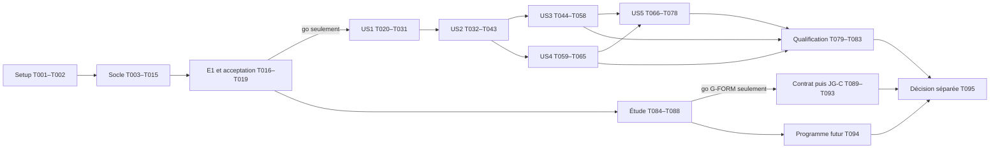

# Tasks: Import géométrique et maillage monoélément

**Feature** : `001-import-maillage-monoelement` — préparation autorisée le 2026-10-31.
**État R2** : 95 tâches prévues, toutes non exécutées ; implémentation suspendue pendant la réconciliation. Aucun code produit ni preuve de maillage présent à l’inventaire initial.
**Entrées** : [spec.md](spec.md), [plan.md](plan.md), research, data-model, topology,
geometry-verification, mesh-quality, build-and-library, verification, quickstart, tous les
[contrats](contracts/README.md) et la constitution 1.1.0, la [roadmap produit](../../docs/product-roadmap.md), [l’étude conique](conical-study.md) et [le registre de réconciliation](reconciliation.md). Analyse : [tasks-analysis.md](tasks-analysis.md).
Les chemins des tâches sont relatifs à la racine du dépôt ; ce sont les fichiers à créer
ou modifier lors de la réalisation, et non des artefacts déjà présents.

Les essais sont exigés par la spécification et la demande utilisateur. **IMP** = implémentation,
**EXP** = expérience exploratoire avec décisions et échecs conservés,
**ESS** = préparation/exécution partielle d’essais, sans acceptation implicite,
**ACC** = essai d’acceptation ou revue de ses preuves. Le résultat concret est l’action de
chaque ligne ; fichiers, dépendances, exigences, vérification et preuves sont donnés dessous.
Une case terminée signifiera que l’action et sa vérification ont été exécutées, jamais que
le fichier existe seulement. Une FR n’est vérifiée qu’après son essai d’acceptation référencé
et la revue de sa preuve ; couverture documentaire ≠ vérification du produit.

`[P]` autorise un travail parallèle seulement quand toutes les dépendances nommées sont
terminées et que les fichiers sont disjoints. Les dépendances priment sur l’ordre de lecture.
Les tâches ACC ne peuvent pas être cochées par skip ou sur la seule rédaction des tests.

## Phase 1 — Setup strictement nécessaire à J0

But : construire le noyau/démonstration sur CPU sans attendre aucun parcours utilisateur.
Test indépendant : presets fonctionnels, smoke réellement exécuté, dépendances locales et flags contrôlés.

- [ ] T001 IMP — Construire le socle CPU C++20 et la cible de démonstration CTest, sans référence à des sources futures ni attente de la CLI. Fichiers : `CMakeLists.txt`; `CMakePresets.json`; `cmake/CoreTests.cmake`; `tests/CMakeLists.txt`; `tests/unit/test_smoke.cpp`.
  - Dépendances : aucune. Exigences : FR-030, FR-045.
  - Vérification : Configurer/compiler cpu-debug et cpu-release avec noyau minimal et test smoke exécuté ; flags sans fast-math, contraction contrôlée, aucun toolkit CUDA recherché. Ajouter cpu-sanitize.
  - Preuve attendue : Commandes, logs, compilateurs et flags dans evidence/J0/build/.
  - Statut réel : prévu, non exécuté ; aucune validation produit ; démarrage suspendu pendant la réconciliation.

- [ ] T002 IMP — Figer les seules dépendances nécessaires à J0 et leurs notices, sans téléchargement à la configuration. Fichiers : `cmake/Dependencies.cmake`; `third_party/manifest.json`; `third_party/notices/`; `tests/unit/test_build_contract.cpp`.
  - Dépendances : T001. Exigences : FR-029, FR-030, FR-045.
  - Vérification : Résoudre localement nlohmann/json, Catch2 et le sous-ensemble de prédicats ; compiler sans réseau ; identifier les empreintes exactes. OpenSSL, yaml-cpp et lecteurs VTK attendent leurs phases.
  - Preuve attendue : Inventaire version/licence/SHA-256 et log de construction hors réseau dans evidence/J0/build/.
  - Statut réel : prévu, non exécuté ; aucune validation produit ; démarrage suspendu pendant la réconciliation.

## Phase 2 — Socle bloquant et J0 (aucun parcours complet requis)

But : démontrer la construction 4/5 blocs avant généralisation. Le cœur partagé produit les
cartes ; seul le contour d’entrée est un adaptateur analytique de test. Les contrôleurs
indépendants numériques et l’oracle polynomial ciblé doivent suffire à toutes les limites
applicables de J0. Les évaluateurs généraux de contours importés restent après le go.

Le label CTest `topology-demo` sera enregistré pendant cette phase, sans attendre T079.
Les fichiers de configuration J0 sont des entrées d’expériences versionnées, non un contrat
déjà qualifié. Chaque tâche conserve les échecs et les paramètres utilisés.

- [ ] T003 IMP — Définir les types de coordonnées, repères, IDs, diagnostics et vues de maillage contiguës minimales. Fichiers : `include/aero25d/mesh/types.hpp`; `include/aero25d/mesh/mesh.hpp`; `include/aero25d/mesh/diagnostic.hpp`; `tests/unit/test_mesh_storage.cpp`.
  - Dépendances : T002. Exigences : FR-006, FR-010, FR-014, FR-016, FR-024 ; FR-047, FR-048, FR-059.
  - Vérification : Exécuter les contrôles de tailles/overflow, indexation i rapide, durée de vie des vues et valeurs finies ; distinguer IDs source base 1 et maillage base 0. R2 : Définir des types simples séparant source line of flight, LogicalTopology, PlanarPhysicalSection/View, transformations/bases et métriques euclidiennes ; aucun contrat métrique conique obligatoire.
  - Preuve attendue : Log et inventaire des structures/repères dans evidence/J0/storage/.
  - Statut réel : prévu, non exécuté ; aucune validation produit ; démarrage suspendu pendant la réconciliation.

- [ ] T004 [P] IMP — Créer les références synthétiques V-01/02/03 et un oracle indépendant des algorithmes de génération. Fichiers : `tests/data/reference/generate_profiles.cpp`; `tests/data/reference/analytic_oracle.cpp`; `tests/data/V01/`; `tests/data/V02/`; `tests/data/V03/`; `tests/data/reference/oracles.json`.
  - Dépendances : T002. Exigences : FR-006, FR-008, FR-011, FR-013, FR-045.
  - Vérification : Produire les formules et 2048 intervalles prescrits, V-03 fourni/complété et métadonnées attendues ; vérifier rayon 0,0128, épaisseur 0,02, tangentes et transformations avec arithmétique bornée indépendante. Ne pas utiliser le lecteur testé pour les attendus.
  - Preuve attendue : Sources/digests, formule/version, lexèmes, bornes et oracles dans evidence/J0/references/.
  - Statut réel : prévu, non exécuté ; aucune validation produit ; démarrage suspendu pendant la réconciliation.

- [ ] T005 IMP — Fournir les prédicats robustes et les bornes numériques strictement utiles aux transformations et aux cellules de J0. Fichiers : `src/geometry/predicates.cpp`; `src/geometry/interval_core.cpp`; `include/aero25d/mesh/numeric.hpp`; `tests/unit/test_numeric_core.cpp`.
  - Dépendances : T003. Exigences : FR-003, FR-007, FR-009, FR-022, FR-045.
  - Vérification : Exécuter orientations difficiles, aires/Jacobiens bornés, sqrt et sin/cos 0°/25°/50° suivant geometry-verification.md ; un intervalle croisant une limite bloque. Conserver les conditions d’arrondi ; pas encore de Hausdorff général.
  - Preuve attendue : Vecteurs attendus/obtenus, bornes et flags dans evidence/J0/numeric/.
  - Statut réel : prévu, non exécuté ; aucune validation produit ; démarrage suspendu pendant la réconciliation.

- [ ] T006 IMP — Brancher les contours analytiques de test sur le noyau et appliquer S→N→W et son inverse avec les références originales. Fichiers : `src/geometry/frame_chain.cpp`; `include/aero25d/mesh/contour_view.hpp`; `tests/topology_demo/analytic_contour_adapter.cpp`; `tests/unit/test_frame_chain.cpp`.
  - Dépendances : T003, T004, T005. Exigences : FR-006, FR-007, FR-009, FR-010, FR-045 ; FR-047, FR-048, FR-055, FR-059.
  - Vérification : Comparer tous les points aux oracles pour les trois flèches, translations/échelles et axes Y/η ; résidus ≤10⁻¹² c. L’adaptateur fournit positions/dérivées/coins analytiques sans implémenter un second mailleur. R2 : Identifier explicitement planar-extrusion-v1 et S line of flight ; limiter cette transformation aux modes plans, préserver Y/η et les correspondances, sans transformation conique supposée.
  - Preuve attendue : Tables source/normal/travail, inverse, c et axes dans evidence/J0/transforms/.
  - Statut réel : prévu, non exécuté ; aucune validation produit ; démarrage suspendu pendant la réconciliation.

- [ ] T007 IMP — Implémenter le registre de courbes/interfaces uniques et les tables de blocs/frontières orientées. Fichiers : `src/meshing/interface_registry.cpp`; `include/aero25d/mesh/topology.hpp`; `tests/unit/test_interface_registry.cpp`.
  - Dépendances : T003, T005. Exigences : FR-014, FR-016, FR-017, FR-022 ; FR-048, FR-059.
  - Vérification : Contrôler couverture de chaque côté, IDs partagés, permutations et normales opposées ; rejeter partenaire absent/dupliqué et compte incompatible sans collage géométrique. R2 : Les tableaux de blocs/raccords constituent la topologie logique ; leurs courbes physiques sont celles de la représentation plane explicite, sans qualification conique.
  - Preuve attendue : Tables de raccord attendues/obtenues et diagnostics négatifs dans evidence/J0/interfaces/.
  - Statut réel : prévu, non exécuté ; aucune validation produit ; démarrage suspendu pendant la réconciliation.

- [ ] T008 [P] IMP — Construire directement le graphe fin à quatre blocs U/L/WU/WL et son squelette admissible. Fichiers : `src/meshing/thin_topology.cpp`; `tests/topology_demo/test_thin_skeleton.cpp`.
  - Dépendances : T006, T007. Exigences : FR-014, FR-015, FR-016, FR-017, FR-045.
  - Vérification : Sur V-01/V-02 à trois flèches, confronter tous les côtés et IF-LE/U/L/WAKE à topology.md ; longueurs strictement positives, aucun bloc de culot écrasé et squelette sans intersection.
  - Preuve attendue : Graphes, coordonnées des courbes, comptes et contrôles dans evidence/J0/thin/.
  - Statut réel : prévu, non exécuté ; aucune validation produit ; démarrage suspendu pendant la réconciliation.

- [ ] T009 [P] IMP — Construire le graphe épais à cinq blocs et les secteurs positifs des deux lèvres avec une vraie paroi de culot. Fichiers : `src/meshing/thick_topology.cpp`; `tests/topology_demo/test_thick_skeleton.cpp`.
  - Dépendances : T006, T007. Exigences : FR-013, FR-015, FR-016, FR-017, FR-045.
  - Vérification : Sur V-03 fourni/complété à trois flèches, vérifier IF-CU/CL, déterminants locaux, normales par face, lèvres distinctes et culot conservé ; refuser secteur nul/inversé avec cause.
  - Preuve attendue : Cartes de secteurs, déterminants et tables du culot dans evidence/J0/thick/.
  - Statut réel : prévu, non exécuté ; aucune validation produit ; démarrage suspendu pendant la réconciliation.

- [ ] T010 IMP — Résoudre les distributions et bandes minimales de démonstration, avec paramètres demandés et effectifs archivés. Fichiers : `src/meshing/distributions.cpp`; `src/meshing/wall_bands.cpp`; `tests/data/configs/J0/`; `tests/unit/test_distributions.cpp`.
  - Dépendances : T008, T009. Exigences : FR-011, FR-018, FR-019, FR-021, FR-045.
  - Vérification : Utiliser densité/concentrations et lois normales prescrites ; vérifier hauteur/growth, comptes conformes, cœur Hcore et Lnear gelé ; refus explicite si contraintes incompatibles. Toute modification des entrées initiales est versionnée avant verdict.
  - Preuve attendue : Configurations J0, lois/pas/régions et incompatibilités dans evidence/J0/distributions/.
  - Statut réel : prévu, non exécuté ; aucune validation produit ; démarrage suspendu pendant la réconciliation.

- [ ] T011 IMP — Remplir les cartes du noyau par bandes fixées et TFI, sans lissage masquant une inversion initiale. Fichiers : `src/meshing/transfinite.cpp`; `src/meshing/generate.cpp`; `tests/topology_demo/test_initial_maps.cpp`.
  - Dépendances : T010. Exigences : FR-014, FR-015, FR-017, FR-018, FR-045.
  - Vérification : Générer les neuf cartes et variantes V-03 ; vérifier immédiatement chaque Jacobien et conserver la première carte inversée si échec. Aucun réordonnancement de connectivité pour cacher une carte négative.
  - Preuve attendue : Maillages initiaux, états et premières erreurs dans evidence/J0/maps/.
  - Statut réel : prévu, non exécuté ; aucune validation produit ; démarrage suspendu pendant la réconciliation.

- [ ] T012 IMP — Construire le contrôleur indépendant de validité locale et globale, utilisable sans régénération. Fichiers : `src/quality/integrity.cpp`; `src/quality/intersections.cpp`; `tests/topology_demo/test_integrity_injections.cpp`.
  - Dépendances : T005, T007. Exigences : FR-003, FR-016, FR-022, FR-024, FR-045.
  - Vérification : Exécuter toutes cellules/faces/interfaces : cycles exacts, aires et quatre Jacobien positifs bornés, dégénérescence, fermeture, couverture, recouvrement interblocs et exclusion du solide. Détecter les mutations inversées/croisées, trou et chevauchement indépendamment du succès du générateur.
  - Preuve attendue : Mesures exhaustives et matrice des défauts détectés dans evidence/J0/integrity/.
  - Statut réel : prévu, non exécuté ; aucune validation produit ; démarrage suspendu pendant la réconciliation.

- [ ] T013 IMP — Calculer centroïdes, distances de paroi par face et métriques Q1 applicables aux cartes analytiques. Fichiers : `src/quality/cell_metrics.cpp`; `src/quality/wall_metrics.cpp`; `src/quality/profile_q1.cpp`; `tests/unit/test_quality_primitives.cpp`.
  - Dépendances : T005, T007, T012. Exigences : FR-019, FR-022, FR-023, FR-024, FR-045 ; FR-048, FR-056, FR-059.
  - Vérification : Tester centroïdes non assimilés aux moyennes, deux mesures aux coins, hauteurs/distances positives, orthogonalité, ratios de pas/étirement orienté et limites Q1/ulp ; critique si >30° paroi ou erreur h1>2 %. Aucun contrôle critique de J0 omis. R2 : Étiqueter ces mesures comme euclidiennes planes, avec association cellule/face ; ne pas en déduire un contrat ou une validité coniques.
  - Preuve attendue : Valeurs par cellule/face, limites et intervalles dans evidence/J0/quality/.
  - Statut réel : prévu, non exécuté ; aucune validation produit ; démarrage suspendu pendant la réconciliation.

- [ ] T014 IMP — Certifier la fidélité et les caractéristiques de la démonstration par un oracle polynomial ciblé indépendant. Fichiers : `tests/topology_demo/test_analytic_fidelity.cpp`; `tests/data/reference/bounded_polynomial_checks.cpp`.
  - Dépendances : T004, T005, T006, T011. Exigences : FR-011, FR-012, FR-013, FR-045.
  - Vérification : Borner polyligne-source/analytique et analytique/paroi dans S/N/W : ≤10⁻⁴ c et ≤10⁻⁵ c, positions ≤10⁻¹² c, angles ≤0,1°, rayon transformé ≤1 % ; vérifier absence d’oscillation/intersection. Refuser une borne indécise ; aucun évaluateur général de spline requis.
  - Preuve attendue : Certificats de subdivision, erreurs résiduelles et références transformées dans evidence/J0/fidelity/.
  - Statut réel : prévu, non exécuté ; aucune validation produit ; démarrage suspendu pendant la réconciliation.

- [ ] T015 IMP — Écrire les exports minimaux VTP/VTM/VTS et les vues de contrôle de la démonstration. Fichiers : `src/io/vtk_xml.cpp`; `src/io/svg.cpp`; `tests/topology_demo/write_inspection.cpp`.
  - Dépendances : T003, T007, T011. Exigences : FR-027, FR-028, FR-041, FR-042, FR-045 ; FR-047, FR-056, FR-059.
  - Vérification : Produire blocs structurés, contours/frontières par rôle, IDs, repères/unités et liens relatifs ; zooms BA et deux lèvres avec sommets/secteurs. Relier les IDs du diagnostic disponible ; marquer tout essai invalide. La qualification VTK/ParaView complète attend US3. R2 : Déclarer Float64 et représentation plane physique versus indices logiques, distinguer PointData/CellData et conserver associations/IDs ; aucun champ de pression fictif.
  - Preuve attendue : Exports, index et vues détaillées dans evidence/J0/inspection/.
  - Statut réel : prévu, non exécuté ; aucune validation produit ; démarrage suspendu pendant la réconciliation.

- [ ] T016 EXP — Explorer E1 sur les cartes usuelles, diagnostiquer les coins et fixer les paramètres explicites candidats de J0. Fichiers : `tests/topology_demo/run_e1.cpp`; `tests/data/configs/J0/`; `evidence/J0/E1/experiment.md`.
  - Dépendances : T011, T012, T013, T014, T015. Exigences : FR-015, FR-018, FR-022, FR-023, FR-045.
  - Vérification : Exécuter les neuf configurations et les deux fermetures V-03 avec tous contrôleurs ; conserver réussites et échecs. Si besoin revoir construction/bandes/transition sans changer les seuils ; le besoin du lissage est une décision expérimentale, pas une présomption de validité.
  - Preuve attendue : Table d’expériences, diffs de paramètres/construction, mesures et conclusion candidate, aucun go implicite.
  - Statut réel : prévu, non exécuté ; aucune validation produit ; démarrage suspendu pendant la réconciliation.

- [ ] T017 ACC — Éprouver l’indépendance du cœur et les refus ciblés nécessaires à la validité de J0. Fichiers : `tests/topology_demo/test_frozen_core.cpp`; `tests/topology_demo/test_limit_refusals.cpp`.
  - Dépendances : T016. Exigences : FR-013, FR-018, FR-021, FR-022, FR-045.
  - Vérification : Exécuter sur fin/épais à 25° deux domaines compatibles R=10c/20c et comparer exactement le cœur ; injecter coin incompatible et culot mince non nul. Exiger succès ou refus motivé pour les limites, jamais conversion en pointe. Ces essais ne remplacent pas les neuf cas usuels.
  - Preuve attendue : Comparaison des coordonnées gelées et dossiers de refus dans evidence/J0/core-and-limits/.
  - Statut réel : prévu, non exécuté ; aucune validation produit ; démarrage suspendu pendant la réconciliation.

- [ ] T018 ACC — Exécuter l’acceptation J0 sur les neuf configurations obligatoires et V-03 dans ses deux fermetures. Fichiers : `tests/topology_demo/test_j0_acceptance.cpp`; `tests/topology_demo/CMakeLists.txt`; `tests/topology_demo/archive_evidence.cmake`; `evidence/J0/acceptance.json`.
  - Dépendances : T016, T017. Exigences : FR-006, FR-009, FR-013, FR-014, FR-015, FR-016, FR-019, FR-022, FR-023, FR-045; SC-002 (partiel) ; FR-059.
  - Vérification : Exécuter CTest topology-demo et exiger tous critères du bloc « Passage J0 » ci-dessous, sans skip ni exclusion des coins ; les neuf lignes doivent passer, plus variantes V-03. Archiver compte contrôlé=compte réel et les vues BA/lèvres ; calculer les empreintes de preuve avec file(SHA256) CMake, sans Python. R2 : Le passage reste exclusivement plan et indépendant de G-FORM/JG-C ; ni étude conique ni qualification future ne conditionne ces neuf cas.
  - Preuve attendue : Commandes/codes/logs, rapports exhaustifs, versions/digests et vues dans evidence/J0/qualification/.
  - Statut réel : prévu, non exécuté ; aucune validation produit ; démarrage suspendu pendant la réconciliation.

- [ ] T019 ACC — Prononcer et consigner le go/no-go documentaire du jalon à partir des essais effectivement exécutés. Fichiers : `evidence/J0/decision.md`; `evidence/J0/index.json`; `specs/001-import-maillage-monoelement/coherence-review.md`.
  - Dépendances : T018. Exigences : FR-045 ; FR-059, FR-060.
  - Vérification : Contrôler complétude et contenu des preuves, limites, neuf succès et fermetures V-03, date/auteur du verdict. Sur no-go conserver preuves et diagnostic, revenir aux tâches de construction puis rejouer T016–T019 ; toutes phases suivantes restent bloquées. R2 : Le go ne porte que sur J0 plan ; conserver sa décision sans l’étendre au conique. Une future construction conique a son propre go scientifique et JG-C.
  - Preuve attendue : Décision motivée, critères un à un, limitations de portée (analytique seulement) et révisions nécessaires.
  - Statut réel : prévu, non exécuté ; aucune validation produit ; démarrage suspendu pendant la réconciliation.

## Phase 3 — US1 : Contrôler un profil sans lancer de calcul (P1)

But : import complet, provenance, indications et reconstruction certifiée consultables sans mailleur.
**Préalable bloquant** : go J0 T019. **Test indépendant** : T031 sur V-01–06/I-01–24,
avec mêmes source/repères, diagnostics attendus et budgets H-07/H-08, zéro génération.
Préparer les tests avant les composants associés, puis les rejouer à l’acceptation.

- [ ] T020 [P] [US1] ESS — Préparer le corpus d’acceptation d’import, ambiguïtés et multiéléments avec attendus indépendants. Fichiers : `tests/data/reference/generate_mutations.py`; `tests/data/V04/`; `tests/data/V05/`; `tests/data/V06/`; `tests/integration/test_import_acceptance.cpp`.
  - Dépendances : T019. Exigences : FR-001, FR-002, FR-003, FR-004, FR-005, FR-008, FR-013; SC-001, SC-003.
  - Vérification : Exécuter la génération des I-01 à I-24 et manifestes de lignes/étapes ; préparer les assertions du lecteur sans calculer l’attendu avec celui-ci. I-18/I-23 restent importables/inspectables selon leur étape. L’acceptation attend T031.
  - Preuve attendue : Fixtures/digests, statuts/localisations attendus et premier log de tests dans evidence/US1/corpus/.
  - Statut réel : prévu, non exécuté ; aucune validation produit ; démarrage suspendu pendant la réconciliation.

- [ ] T021 [P] [US1] ESS — Préparer les tests de contrats de configuration, rapports et indices d’indications. Fichiers : `tests/contracts/test_unit_schemas.py`; `tests/data/contracts/unit_cases.json`; `tests/contracts/test_representation_schema.py`.
  - Dépendances : T019. Exigences : FR-006, FR-008, FR-018, FR-024, FR-026 ; FR-048, FR-049, FR-056, FR-057.
  - Vérification : Valider les schémas avec jsonschema 2020-12 ; tester champs inconnus, défauts, indices entiers ou {segment_id,t}, nombres non finis et paramètres hors plage. Distinguer forme JSON et invariants numériques à éprouver ensuite. R2 : Préparer les cas schémas 1.2/lecture legacy 1.0, YAML unitaire équivalent, geometry_mode explicite, planar_2d avec Λ=0 et refus des champs de vol/effilement actifs. Ajouter representation.schema.json aux tests.
  - Preuve attendue : Versions du validateur et résultats positifs/négatifs dans evidence/US1/contracts/.
  - Statut réel : prévu, non exécuté ; aucune validation produit ; démarrage suspendu pendant la réconciliation.

- [ ] T022 [US1] IMP — Implémenter la lecture à états et la provenance immuable, avec SHA-256, perte de précision décimale et tailles contrôlées. Fichiers : `src/geometry/reader.cpp`; `src/geometry/source_document.cpp`; `src/io/sha256.cpp`; `cmake/PersistenceDependencies.cmake`; `third_party/manifest.json`; `tests/unit/test_reader.cpp`.
  - Dépendances : T020, T021. Exigences : FR-001, FR-002, FR-004, FR-005, FR-007.
  - Vérification : Ajouter OpenSSL Crypto après J0 pour les empreintes (source/version/notice figées), puis exécuter variantes lexicales/comptage, conversion arrondie et collisions de décimaux distincts (PRECISION_LOSS), overflow avant allocation ; conserver tous éléments/lexèmes/lignes même sur refus.
  - Preuve attendue : Tableaux attendus/obtenus, octets avant/après et diagnostics dans evidence/US1/reader/.
  - Statut réel : prévu, non exécuté ; aucune validation produit ; démarrage suspendu pendant la réconciliation.

- [ ] T023 [US1] IMP — Contrôler l’intégrité des contours sources et les contacts interéléments sans réparation. Fichiers : `src/geometry/validate.cpp`; `src/geometry/segment_index.cpp`; `tests/unit/test_source_integrity.cpp`.
  - Dépendances : T022, T005. Exigences : FR-003, FR-004, FR-005.
  - Vérification : Exécuter croisements, contacts tangents, recouvrements, répétition terminale autorisée, doublons interdits et proximité sans contact ; les prédicats portent sur les coordonnées représentées, pas seulement une normalisation arrondie.
  - Preuve attendue : Localisations source et comparaison de tous les défauts V-04/06 dans evidence/US1/integrity/.
  - Statut réel : prévu, non exécuté ; aucune validation produit ; démarrage suspendu pendant la réconciliation.

- [ ] T024 [US1] IMP — Identifier BA/branches/lèvres/culot et appliquer uniquement les indications et fermetures confirmées. Fichiers : `src/geometry/features.cpp`; `src/geometry/closure.cpp`; `tests/unit/test_feature_hints.cpp`.
  - Dépendances : T023. Exigences : FR-006, FR-008, FR-013; SC-003.
  - Vérification : Exécuter fenêtres 3/5/9, candidats multiples, indices/positions sur segments, V-05 avec/sans/contradiction ; culot fourni préservé, droite ajoutée seulement confirmée ; refus du maillage multiélément sans perte à l’import.
  - Preuve attendue : Candidats, indications, segments avant/après, références et statuts dans evidence/US1/features/.
  - Statut réel : prévu, non exécuté ; aucune validation produit ; démarrage suspendu pendant la réconciliation.

- [ ] T025 [US1] IMP — Compléter la résolution des configurations et transformations pour les données importées. Fichiers : `src/io/configuration.cpp`; `src/io/document_reader.cpp`; `cmake/DocumentDependencies.cmake`; `third_party/manifest.json`; `include/aero25d/mesh/configuration.hpp`; `tests/unit/test_resolved_configuration.cpp`; `tests/integration/test_imported_frames.cpp`.
  - Dépendances : T021, T024, T006. Exigences : FR-006, FR-007, FR-009, FR-010, FR-018, FR-030 ; FR-047, FR-048, FR-049, FR-057.
  - Vérification : Exécuter paramètres négatifs/infinis, incompatibilités, chemins relatifs, unités/échelle et transformation globale un/deux éléments ≤10⁻¹² c. Archiver demandes, omissions et toutes valeurs dérivées sans substitution cachée. R2 : Introduire yaml-cpp 0.8.0 (source/SHA/notices) dans aero25d_document_io après J0 : lecteur JSON/YAML partagé, règles uniques et base des chemins. Valider geometry_mode (planar_2d ⇒ Λ=0), migration legacy archivée et refus UNSUPPORTED_GEOMETRY_MODE/UNSUPPORTED_FLOW_INPUT, sans ignorer de champ actif.
  - Preuve attendue : Demandé/résolu, chaînes/inverses et résidus par point dans evidence/US1/configuration/.
  - Statut réel : prévu, non exécuté ; aucune validation produit ; démarrage suspendu pendant la réconciliation.

- [ ] T026 [US1] IMP — Reconstruire les arcs cubiques clamped à coins protégés et fournir l’interface de contour du noyau. Fichiers : `src/geometry/reconstruction.cpp`; `src/geometry/bezier.cpp`; `tests/unit/test_reconstruction.cpp`.
  - Dépendances : T024, T025. Exigences : FR-011, FR-013.
  - Vérification : Exécuter interpolation, BA C1 à courbures unilatérales, tangentes 5/7/9, droite de culot exacte et coins non lissés ; aucune suppression de point ni repli polyligne automatique.
  - Preuve attendue : Coefficients, continuités et positions protégées dans evidence/US1/reconstruction/.
  - Statut réel : prévu, non exécuté ; aucune validation produit ; démarrage suspendu pendant la réconciliation.

- [ ] T027 [US1] IMP — Implémenter les évaluateurs généraux bornés de fidélité, régularité et intersections des reconstructions. Fichiers : `src/geometry/bounded_distance.cpp`; `src/geometry/curve_validation.cpp`; `tests/unit/test_bounded_geometry.cpp`.
  - Dépendances : T026, T005. Exigences : FR-003, FR-011, FR-012, FR-024.
  - Vérification : Exécuter subdivisions Bézier, Hausdorff bidirectionnel, extrema/régularité et refus indéterminé ; comparer oracle analytique dans S/N/W avec méthode/couverture/erreur résiduelle et bornes conformes aux budgets H-07.
  - Preuve attendue : Certificats et cas non certifiables, coûts observés dans evidence/US1/bounded-geometry/.
  - Statut réel : prévu, non exécuté ; aucune validation produit ; démarrage suspendu pendant la réconciliation.

- [ ] T028 [US1] IMP — Borner courbures/rayons et angles transformés et distinguer forme connue et rayon inconnu. Fichiers : `src/geometry/curvature.cpp`; `tests/unit/test_curvature_angles.cpp`.
  - Dépendances : T026, T027. Exigences : FR-011, FR-012.
  - Vérification : Exécuter rayon BA source/normal/travail, deux côtés et angles de coins H-08 ; intervalles assez fins (0,01 % rayon, 0,001° angle). I-23 ne reçoit pas de certificat de rayon réel ; dispersion des estimations explicitée.
  - Preuve attendue : Références transformées, rayons unilatéraux/dispersion et bornes dans evidence/US1/curvature/.
  - Statut réel : prévu, non exécuté ; aucune validation produit ; démarrage suspendu pendant la réconciliation.

- [ ] T029 [US1] EXP — Exécuter E2 pour la reconstruction comprimée et décider explicitement les révisions nécessaires avant gel. Fichiers : `tests/integration/run_e2.cpp`; `evidence/US1/E2/experiment.md`; `specs/001-import-maillage-monoelement/geometry-verification.md`.
  - Dépendances : T027, T028. Exigences : FR-011, FR-012.
  - Vérification : Comparer V-01/02/03 à trois flèches aux oracles, y compris sous-échantillonnage ; mesurer précision/coût, conserver les échecs. Toute révision de méthode/fixture est justifiée puis rejouée ; pas de certification par image.
  - Preuve attendue : Balayage, certificats, décision méthode et historique des révisions dans evidence/US1/E2/.
  - Statut réel : prévu, non exécuté ; aucune validation produit ; démarrage suspendu pendant la réconciliation.

- [ ] T030 [US1] IMP — Exposer le parcours C++ de contrôle/inspection sans générateur, avec statuts et figures de contours. Fichiers : `src/geometry/check_geometry.cpp`; `include/aero25d/mesh/geometry.hpp`; `tests/integration/test_check_without_mesh.cpp`.
  - Dépendances : T022, T023, T024, T025, T029, T015. Exigences : FR-004, FR-005, FR-008, FR-026, FR-028, FR-041, FR-042 ; FR-047, FR-054.
  - Vérification : Exécuter contrôle seul valide/invalide/ambigu/multiélément ; zéro appel au générateur, coordonnées et provenance consultables et vues source/reconstruction marquées selon étapes réellement achevées. R2 : Exposer les correspondances en S original line of flight et N physique plan, sans calculer p/Cp ni confondre un mapping géométrique et une reconstruction de solution.
  - Preuve attendue : Résultats typés, compteurs d’appels, contours VTP/SVG et diagnostics dans evidence/US1/check/.
  - Statut réel : prévu, non exécuté ; aucune validation produit ; démarrage suspendu pendant la réconciliation.

- [ ] T031 [US1] ACC — Exécuter l’acceptation indépendante US1 sur tous les cas de lecture, repères, reconstruction et ambiguïtés. Fichiers : `tests/integration/test_import_acceptance.cpp`; `tests/integration/test_geometry_fidelity.cpp`; `evidence/US1/acceptance.md`.
  - Dépendances : T020, T021, T029, T030. Exigences : FR-001, FR-002, FR-003, FR-004, FR-005, FR-006, FR-007, FR-008, FR-009, FR-010, FR-011, FR-012, FR-013; SC-001, SC-003 ; FR-047, FR-048, FR-049, FR-057; SC-009.
  - Vérification : Exécuter V-01–06 et I-01–24 ; comparer chaque statut/étape/localisation à l’oracle, résidus ≤10⁻¹² c et budgets H-07/H-08 ; aucune exigence cochée si test non exécuté ou certificat absent. R2 : Exécuter aussi V-11 sur les configurations JSON/YAML, modèles 1.2/legacy, mappings et refus explicites ; aucune dépendance G-FORM.
  - Preuve attendue : Matrice attendus/observés, logs et certificats référencés par FR dans evidence/US1/.
  - Statut réel : prévu, non exécuté ; aucune validation produit ; démarrage suspendu pendant la réconciliation.

## Phase 4 — US2 : Obtenir un maillage contrôlé pour une section en flèche (P1)

But : appliquer les cartes démontrées aux contours importés et assurer qualité complète/refus explicites.
**Test indépendant** : T041–T043, neuf configurations et deux fermetures V-03, Q1 figé,
toutes cellules/interfaces et défauts V-08. Les très petits culots E3 peuvent être refusés.

- [ ] T032 [US2] ESS — Préparer les défauts injectés V-08 et contrats de génération/qualité complets avec oracles de métriques. Fichiers : `tests/data/V08/`; `tests/data/reference/mesh_mutations.py`; `tests/integration/test_mesh_defects.cpp`.
  - Dépendances : T031. Exigences : FR-018, FR-019, FR-022, FR-023, FR-024; SC-006.
  - Vérification : Préparer toutes mutations prescrites, attentes par cellule/face/raccord et limites/ulp ; exercer le contrôleur existant. L’exécution d’acceptation complète attend T042.
  - Preuve attendue : Maillages modifiés, oracles analytiques et log initial dans evidence/US2/defects/.
  - Statut réel : prévu, non exécuté ; aucune validation produit ; démarrage suspendu pendant la réconciliation.

- [ ] T033 [US2] IMP — Raccorder les contours importés certifiés aux cartes du noyau, en contrôlant l’admissibilité sans changer leur géométrie. Fichiers : `src/meshing/admissibility.cpp`; `src/meshing/generate.cpp`; `tests/integration/test_imported_meshing.cpp`.
  - Dépendances : T031, T011. Exigences : FR-005, FR-011, FR-013, FR-014, FR-015, FR-017.
  - Vérification : Exécuter fin/épais importés, culot fourni/confirmé, formes rentrantes et multielement ; distinguer profil invalide, topologie hors portée et paramètres incompatibles. Réutiliser intégralement les constructeurs J0.
  - Preuve attendue : Comparaison analytique/import et refus typés dans evidence/US2/admissibility/.
  - Statut réel : prévu, non exécuté ; aucune validation produit ; démarrage suspendu pendant la réconciliation.

- [ ] T034 [US2] IMP — Compléter la redistribution adaptative, les raccords de croissance et les contrôles de chaque paramètre. Fichiers : `src/geometry/redistribution.cpp`; `src/meshing/distributions.cpp`; `tests/integration/test_parameter_effects.cpp`.
  - Dépendances : T033, T027. Exigences : FR-011, FR-012, FR-017, FR-018, FR-019, FR-021.
  - Vérification : Exécuter une variation à la fois de tous les paramètres FR-018 ; borner quadrature/inversion à 10⁻¹⁰ c et paroi à 10⁻⁵ c ; contrôler compte de couche, croissance, culot/sillage et domaine sans résolution accrue silencieusement.
  - Preuve attendue : Demandé/résolu, effets mesurés par région et contradictions dans evidence/US2/parameters/.
  - Statut réel : prévu, non exécuté ; aucune validation produit ; démarrage suspendu pendant la réconciliation.

- [ ] T035 [P] [US2] IMP — Ajouter le lissage elliptique déterministe optionnel sous contraintes strictes. Fichiers : `src/meshing/elliptic_smoothing.cpp`; `tests/unit/test_smoothing_constraints.cpp`.
  - Dépendances : T034, T012, T013. Exigences : FR-014, FR-016, FR-018, FR-022, FR-024.
  - Vérification : Exécuter relaxations 1/2 à 2⁻²⁰, arrêt déplacement/résidu pendant 5 balayages et maximum 5000 ; geler côtés/interfaces/deux rangées/cœur ; refuser inversion initiale ou non-convergence et recontrôler toutes cellules.
  - Preuve attendue : Historique résidu/déplacement et identité des lignes gelées dans evidence/US2/smoothing/.
  - Statut réel : prévu, non exécuté ; aucune validation produit ; démarrage suspendu pendant la réconciliation.

- [ ] T036 [US2] IMP — Finaliser le chargement des profils qualité et l’inspecteur exhaustif indépendant, dont fidélité certifiée. Fichiers : `src/quality/profile.cpp`; `src/quality/inspect.cpp`; `tests/unit/test_quality_profile.cpp`.
  - Dépendances : T032, T034, T035, T028. Exigences : FR-012, FR-019, FR-022, FR-023, FR-024.
  - Vérification : Exécuter Q1 et conditions enregistrées, métriques locales/agrégées, toutes faces/interfaces et évaluateurs généraux ; rejeter profil/condition inconnus, intervalle indécidable, critique ou raccord incohérent même si génération réussie.
  - Preuve attendue : Profil/digest, comptes contrôlés et tableaux locaux dans evidence/US2/quality/.
  - Statut réel : prévu, non exécuté ; aucune validation produit ; démarrage suspendu pendant la réconciliation.

- [ ] T037 [P] [US2] IMP — Ajouter uniquement l’estimation facultative y+ fondée sur u_tau fourni, ν et la distance mesurée. Fichiers : `src/quality/yplus_estimate.cpp`; `tests/unit/test_yplus_estimate.cpp`.
  - Dépendances : T025, T013. Exigences : FR-019, FR-020, FR-030.
  - Vérification : Exécuter avec/sans échelle et données physiques, valeurs invalides et deux faces aux coins ; formule u_tau*d_center_m/ν, hypothèse uniforme et statut estimate. Aucun Mach/Reynolds/solution ni valeur garantie.
  - Preuve attendue : Valeurs de référence/calculées et motifs not_requested/unavailable dans evidence/US2/yplus/.
  - Statut réel : prévu, non exécuté ; aucune validation produit ; démarrage suspendu pendant la réconciliation.

- [ ] T038 [US2] EXP — Exécuter E3 et distinguer admissibilité usuelle, refus des limites et éventuelle révision explicite de conception. Fichiers : `tests/integration/run_e3.cpp`; `evidence/US2/E3/experiment.md`; `specs/001-import-maillage-monoelement/mesh-quality.md`.
  - Dépendances : T036, T037. Exigences : FR-013, FR-018, FR-022, FR-023, FR-024.
  - Vérification : Balayer h1/c=10⁻⁴/10⁻⁵/10⁻⁶, g=1,05/1,15/1,25, culot 0,02/10⁻⁶/10⁻¹⁰ c. Les extrêmes peuvent échouer avec cause ; les neuf configurations usuelles restent obligatoires. Conserver distributions et défauts.
  - Preuve attendue : Table complète, domaines d’admissibilité observés et propositions motivées dans evidence/US2/E3/.
  - Statut réel : prévu, non exécuté ; aucune validation produit ; démarrage suspendu pendant la réconciliation.

- [ ] T039 [US2] ACC — Geler pour qualification les fixtures usuelles et Q1 à la lumière de E1–E3, sans effacer leurs échecs. Fichiers : `tests/data/configs/V01.json`; `tests/data/configs/V02.json`; `tests/data/configs/V03.json`; `specs/001-import-maillage-monoelement/contracts/quality-profile-Q1.json`; `evidence/US2/freeze.md`.
  - Dépendances : T019, T029, T038. Exigences : FR-018, FR-022, FR-023, FR-029.
  - Vérification : Revoir limites et méthodes, dater/versionner le gel et lier preuves positives/négatives ; seul le statut frozen_for_qualification change si valeurs inchangées. Une révision de critères exige justification explicite, mise à jour de tous contrats et réexécution des essais affectés, y compris J0.
  - Preuve attendue : Profil/fixtures figés avec digests, décisions et liste des requalifications.
  - Statut réel : prévu, non exécuté ; aucune validation produit ; démarrage suspendu pendant la réconciliation.

- [ ] T040 [US2] IMP — Finaliser les résultats typés et diagnostics de génération, qualité et ressources avant la persistance complète. Fichiers : `include/aero25d/mesh/result.hpp`; `src/meshing/pipeline.cpp`; `tests/integration/test_generation_failures.cpp`.
  - Dépendances : T036, T037, T039. Exigences : FR-004, FR-018, FR-024, FR-026, FR-030.
  - Vérification : Exécuter échec par étape, limite cellules/mémoire et contrôle des tailles avant allocation ; ne publier aucun objet utilisable si critique ; conserver les données partielles et dernier stade. Aucun allègement de résolution.
  - Preuve attendue : Résultats/diagnostics et traces des limites dans evidence/US2/failures/.
  - Statut réel : prévu, non exécuté ; aucune validation produit ; démarrage suspendu pendant la réconciliation.

- [ ] T041 [US2] ACC — Qualifier les neuf configurations usuelles via le parcours import/reconstruction/maillage complet. Fichiers : `tests/integration/test_nine_base_meshes.cpp`; `tests/integration/test_region_coverage.cpp`.
  - Dépendances : T039, T040. Exigences : FR-011, FR-012, FR-013, FR-014, FR-015, FR-016, FR-017, FR-018, FR-019, FR-022, FR-023; SC-002.
  - Vérification : Exécuter V-01/02/03 × 0°/25°/50°, deux fermetures V-03 ; contrôler exhaustivité, Q1 figé et fidélité H-07/H-08. Aucun cas obligatoire remplacé par refus de limite.
  - Preuve attendue : Rapports, certificats, régions et vues de chaque configuration dans evidence/US2/base/.
  - Statut réel : prévu, non exécuté ; aucune validation produit ; démarrage suspendu pendant la réconciliation.

- [ ] T042 [US2] ACC — Exécuter les refus et injections de qualité complets pour détecter tous les défauts V-08. Fichiers : `tests/integration/test_mesh_defects.cpp`; `tests/integration/test_quality_boundaries.cpp`.
  - Dépendances : T032, T040, T041. Exigences : FR-018, FR-019, FR-022, FR-023, FR-024; SC-006.
  - Vérification : Comparer défauts attendus/observés, sévérités, mesures et limites ; rapport d’aspect aligné ne suffit pas au rejet ; défaut critique entraîne toujours échec et données partielles invalides.
  - Preuve attendue : Matrice des injections, tableaux locaux et statuts dans evidence/US2/negative/.
  - Statut réel : prévu, non exécuté ; aucune validation produit ; démarrage suspendu pendant la réconciliation.

- [ ] T043 [US2] ACC — Conclure US2 et exposer les données de maillage au consommateur C++ sans anticiper le solveur. Fichiers : `tests/integration/test_native_views.cpp`; `evidence/US2/acceptance.md`; `include/aero25d/mesh/api.hpp`.
  - Dépendances : T041, T042. Exigences : FR-014, FR-016, FR-020, FR-024, FR-030; SC-002, SC-006 ; FR-048, FR-056.
  - Vérification : Exécuter lecture des vues constantes de coordonnées/connectivité/normales/aires, durée de vie et compteurs ; synthétiser seulement les preuves exécutées. Aucun flux, résidu CFD, allocation GPU ou solveur ajouté. R2 : Démontrer la séparation des vues LogicalTopology et PlanarPhysicalSection, le modèle/version de transformation et les associations, sans signature métrique conique anticipée.
  - Preuve attendue : Exemple compilé/exécuté et bilan FR de US2.
  - Statut réel : prévu, non exécuté ; aucune validation produit ; démarrage suspendu pendant la réconciliation.

## Phase 5 — US3 : Inspecter, exporter et reproduire (P2)

But : dossiers complets et parcours CLI/Python concordants, VTP/VTM/VTS qualifiés et reproduction.
**Test indépendant** : T053–T055/T058, relecture indépendante obligatoire, ouverture ParaView,
ID résolus, cinq vues, reproduction ≤10⁻¹² c et exécution CPU sans dépendances de tests.
La méthode `family` est ajoutée et qualifiée dans US4, sans retarder la qualification unitaire.

- [ ] T044 [US3] ESS — Préparer les tests de contrat du bundle, des exports et de la parité CLI/Python. Fichiers : `tests/contracts/test_bundle_schemas.py`; `tests/contracts/test_cli_protocol.py`; `tests/data/contracts/bundle_cases.json`.
  - Dépendances : T043. Exigences : FR-024, FR-026, FR-027, FR-028, FR-029, FR-041, FR-042 ; FR-048, FR-049, FR-056, FR-057.
  - Vérification : Exercer schémas, corruptions/digests/tailles/chemins et localisations boundary/export_object ; définir assertions stdout JSON unique/stderr et codes. Préparer attentes VTP/VTM/VTS sans les marquer vérifiées avant relecture. R2 : Ajouter schémas de représentation 1.2, associations/tailles de champs, migration explicite des rôles legacy et refus de type physique non supporté.
  - Preuve attendue : Cas positifs/négatifs et log initial dans evidence/US3/contracts/.
  - Statut réel : prévu, non exécuté ; aucune validation produit ; démarrage suspendu pendant la réconciliation.

- [ ] T045 [US3] IMP — Sérialiser la persistance canonique avec publication atomique et intégrité en réutilisant le SHA-256 de T022. Fichiers : `cmake/PersistenceDependencies.cmake`; `src/io/bundle.cpp`; `src/io/binary_arrays.cpp`; `src/io/sha256.cpp`; `third_party/manifest.json`.
  - Dépendances : T044, T022. Exigences : FR-004, FR-007, FR-024, FR-029, FR-030 ; FR-047, FR-048, FR-056, FR-057.
  - Vérification : Exécuter lecture/écriture f64le/u64le, offsets/overflow, SHA-256 et fichiers relatifs ; manifeste valid seulement après contrôles ; échec en dossier .invalid, refus d’écrasement et liens sortants. Réutiliser Crypto seulement, sans réseau ni nouvel algorithme SHA-256. R2 : Écrire représentation plane et fields/association/tuple_count dans le manifeste 1.2 ; conserver [N,2] FP64, topology_space logique et migration 1.0 tracée sans inférer de mode conique.
  - Preuve attendue : Bundles valides/invalides, corruptions et logs d’intégrité dans evidence/US3/bundle/.
  - Statut réel : prévu, non exécuté ; aucune validation produit ; démarrage suspendu pendant la réconciliation.

- [ ] T046 [US3] IMP — Sérialiser les rapports locaux/agrégés, provenance, repères et les cinq figures complètes. Fichiers : `src/io/report_json.cpp`; `src/io/geometry_json.cpp`; `src/io/svg.cpp`; `tests/contracts/test_report_views.py`.
  - Dépendances : T045. Exigences : FR-006, FR-012, FR-019, FR-020, FR-024, FR-028, FR-029 ; FR-048, FR-056.
  - Vérification : Exécuter relecture Python, données finies/null motivé, report.valid=manifest.valid, comptes exhaustifs ; vérifier profile/BA/BF/wake/global avec styles superposés, IDs, zooms, repères et unités. R2 : Décrire les tableaux de cellules/faces avec association, repère, unités et origine ; garder null motivé lorsque mode/représentation sont inconnus après échec.
  - Preuve attendue : Rapports JSON/JSONL et cinq SVG annotés dans evidence/US3/reports/.
  - Statut réel : prévu, non exécuté ; aucune validation produit ; démarrage suspendu pendant la réconciliation.

- [ ] T047 [US3] IMP — Compléter l’export VTP de contours/frontières et l’index des correspondances vers la provenance et les diagnostics. Fichiers : `src/io/vtp_export.cpp`; `src/io/export_index.cpp`; `tests/contracts/test_vtp_metadata.py`.
  - Dépendances : T045, T046, T015. Exigences : FR-027, FR-028, FR-041, FR-042 ; FR-047, FR-054, FR-056.
  - Vérification : Exécuter contrôle seul et maillages fin/épais : rôles 1–6, représentations/masques d’IDs, culot fourni/ajouté, une courbe par interface, repères séparés S/N/W. Aucun faux global_node_id et 100 % des IDs applicables résolus. R2 : Conserver le mapping de provenance line of flight pour chaque représentation et marquer les interpolations de visualisation ; pas de Cp/pression produit par ces exports.
  - Preuve attendue : VTP, export-index.json et tables de correspondance dans evidence/US3/vtp/.
  - Statut réel : prévu, non exécuté ; aucune validation produit ; démarrage suspendu pendant la réconciliation.

- [ ] T048 [US3] IMP — Finaliser VTM/VTS structurés et ensembles d’inspection transportables. Fichiers : `src/io/vts_export.cpp`; `src/io/vtm_export.cpp`; `tests/contracts/test_export_paths.py`.
  - Dépendances : T045, T047. Exigences : FR-014, FR-016, FR-027, FR-041, FR-042 ; FR-048, FR-056.
  - Vérification : Exécuter export fin/épais : extent ni/nj 2D, IDs globaux/métriques/validité, max_digits10, VTM des blocs seulement ; inspection.vtm regroupe VTP N et tous chemins restent relatifs après déplacement. R2 : Vérifier dtype Float64, tuples PointData/CellData selon association et étiquette plane_N/planar-euclidean-v1 ; ne pas présenter une vue logique comme surface physique.
  - Preuve attendue : Ensembles exportés, audit des liens et coordonnées dans evidence/US3/vtm-vts/.
  - Statut réel : prévu, non exécuté ; aucune validation produit ; démarrage suspendu pendant la réconciliation.

- [ ] T049 [US3] IMP — Exposer les commandes unitaires check/mesh/quality/export avec protocole et codes contractuels. Fichiers : `src/cli/main.cpp`; `src/cli/unit_commands.cpp`; `tests/contracts/test_cli_protocol.py`.
  - Dépendances : T046, T047, T048. Exigences : FR-004, FR-024, FR-026, FR-030 ; FR-049.
  - Vérification : Exécuter aide, parcours valides/invalides, --json, out/replace et diagnostic-invalid ; stdout synthèse unique, progression stderr, code reporté. quality réinspecte sans régénérer et export n’altère pas le bundle. R2 : Accepter les deux syntaxes de configuration avec le lecteur partagé et refuser explicitement mode conique/données de vol actives avant génération ; une extension inactive produit un diagnostic visible.
  - Preuve attendue : Transcriptions/code/artefacts et compteurs d’opérations dans evidence/US3/cli/.
  - Statut réel : prévu, non exécuté ; aucune validation produit ; démarrage suspendu pendant la réconciliation.

- [ ] T050 [US3] IMP — Implémenter la reproduction intégrale depuis les entrées archivées et comparer les données sans réutiliser les nœuds comme entrée. Fichiers : `src/io/reproduction.cpp`; `src/cli/reproduce_command.cpp`; `tests/integration/test_reproduction.cpp`.
  - Dépendances : T045, T049. Exigences : FR-007, FR-026, FR-029 ; FR-057.
  - Vérification : Exécuter deux générations même version/environnement : paramètres/connectivité/IDs et décisions identiques, résidus ≤10⁻¹² c ; refuser source corrompue ou résolution incompatible. Environnement différent explicitement non comparable. R2 : Comparer les modèles/versions de représentation et règles de migration ; aucun bundle legacy assimilé à un résultat conique ou réutilisé sans compatibilité.
  - Preuve attendue : Bundles source/replay et rapport de comparaison dans evidence/US3/reproduction/.
  - Statut réel : prévu, non exécuté ; aucune validation produit ; démarrage suspendu pendant la réconciliation.

- [ ] T051 [P] [US3] IMP — Créer le client Python mince, ses résultats/lecteurs séquentiels et exceptions sans logique géométrique. Fichiers : `python/aero25d_mesh/__init__.py`; `python/aero25d_mesh/client.py`; `python/aero25d_mesh/results.py`; `python/aero25d_mesh/errors.py`; `tests/contracts/test_python_client.py`.
  - Dépendances : T049, T050. Exigences : FR-024, FR-026, FR-028, FR-029 ; FR-049, FR-057.
  - Vérification : Exécuter appels shell=False, fichier/dictionnaire avec base_dir, erreurs 2–8/70, transport malformé et raise_on_error=False ; vérifier grands tableaux via chemins/iterateurs et mêmes rapports sans recalcul favorable. R2 : Relayer syntaxe YAML, geometry_mode, refus actifs et diagnostic INACTIVE_EXTENSION sans supprimer de champ ni calculer une clé/restitution propre.
  - Preuve attendue : Comparaisons CLI/Python et erreurs/rapports conservés dans evidence/US3/python/.
  - Statut réel : prévu, non exécuté ; aucune validation produit ; démarrage suspendu pendant la réconciliation.

- [ ] T052 [P] [US3] IMP — Installer un environnement de qualification d’exports distinct et empêcher un succès si le lecteur indépendant manque. Fichiers : `cmake/ExportQualification.cmake`; `tests/qualification/requirements.txt`; `tests/qualification/environment.md`; `tests/qualification/check_reader.py`.
  - Dépendances : T048. Exigences : FR-030, FR-043.
  - Vérification : Figer VTK Python direct ou PyVista+VTK avec versions/notices ; activer AERO25D_EXPORT_QUALIFICATION=ON et vérifier échec explicite si lecteur absent. Le produit BUILD_TESTING=OFF doit pouvoir être installé sans ces paquets.
  - Preuve attendue : Inventaire/licences exacts et logs des deux configurations dans evidence/US3/qualification-env/.
  - Statut réel : prévu, non exécuté ; aucune validation produit ; démarrage suspendu pendant la réconciliation.

- [ ] T053 [US3] ACC — Relire obligatoirement les exports avec VTK ou PyVista, y compris après déplacement et pour les sorties de diagnostic. Fichiers : `tests/qualification/test_vtk_roundtrip.py`; `tests/qualification/test_export_identifiers.py`.
  - Dépendances : T047, T048, T052. Exigences : FR-016, FR-027, FR-041, FR-042, FR-043; SC-008 ; FR-048, FR-056; SC-009.
  - Vérification : Exécuter VTP/VTM/VTS de fin/épais/check : types/comptes/IDs/rôles identiques, références diagnostics résolues à 100 %, coordonnées ≤10⁻¹² c ; tout test absent/non exécuté bloque qualification. Ne pas relire uniquement avec l’exporteur propre. R2 : Comparer types Float64, nombre de tuples et associations PointData/CellData/face, représentations/bases et IDs. Ne jamais interpoler implicitement cellule→sommet pour faire passer la comparaison.
  - Preuve attendue : Versions du lecteur, logs et tables comparées dans evidence/US3/vtk-reader/.
  - Statut réel : prévu, non exécuté ; aucune validation produit ; démarrage suspendu pendant la réconciliation.

- [ ] T054 [US3] ACC — Vérifier l’ouverture effective dans ParaView et inspecter les rôles/repères et les zooms BA/lèvres. Fichiers : `tests/qualification/paraview-opening.md`; `tests/qualification/paraview_smoke.py`; `evidence/US3/paraview/`.
  - Dépendances : T053. Exigences : FR-028, FR-041, FR-042, FR-044; SC-008 ; FR-056.
  - Vérification : Ouvrir les ensembles VTM/VTS/VTP fin/épais et contours seuls, après déplacement ; sélectionner chaque rôle, vérifier absence d’erreur et voir sommets/secteurs aux coins. Conserver version/état à chemins relatifs, logs et captures. ParaView absent ⇒ essai bloqué. R2 : Inspecter aussi les associations et l’étiquette de section physique plane ; aucune vue physique conique n’est annoncée comme disponible.
  - Preuve attendue : Procès-verbal d’ouverture, captures global/BA/lèvres et conclusion humaine explicite.
  - Statut réel : prévu, non exécuté ; aucune validation produit ; démarrage suspendu pendant la réconciliation.

- [ ] T055 [US3] ACC — Exécuter V-09 pour la parité complète des parcours unitaires, refus, exports, figures et reproduction. Fichiers : `tests/contracts/test_python_cli_parity.py`; `tests/integration/test_v09.cpp`.
  - Dépendances : T050, T051, T053, T054. Exigences : FR-020, FR-024, FR-026, FR-027, FR-028, FR-029, FR-041, FR-042, FR-043, FR-044; SC-005, SC-006, SC-008 ; FR-047, FR-049, FR-056, FR-057; SC-009.
  - Vérification : Exécuter V-01/V-03 et refus V-04/V-06 via CLI/Python ; mêmes statuts, connectivités/IDs et mesures à la tolérance archivée ; cinq vues et références lisibles. Inclure avec/sans u_tau, ν et échelle physique pour l’estimation facultative FR-020. Les familles seront complétées en US4. R2 : Comparer JSON/YAML, modèles explicites, mapping S/N et refus coniques/vol actifs depuis CLI/Python ; inclure V-11 et les associations.
  - Preuve attendue : Transcriptions comparées et dossier de preuve V-09 dans evidence/US3/parity/.
  - Statut réel : prévu, non exécuté ; aucune validation produit ; démarrage suspendu pendant la réconciliation.

- [ ] T056 [US3] EXP — Exécuter E5 pour la reproduction interbuild et caractériser les ressources sans promesse de capacité. Fichiers : `tests/qualification/run_e5.py`; `evidence/US3/E5/experiment.md`.
  - Dépendances : T055. Exigences : FR-027, FR-029, FR-030.
  - Vérification : Deux exécutions même environnement puis GCC/Clang contrôlés, corruptions d’artefacts ; enregistrer durée/pic mémoire/nombre cellules/coût évaluateurs et flags. Distinguer reproduction qualifiée et comparaison d’environnements ; expliquer toute dérive de verdict.
  - Preuve attendue : Mesures brutes/contextes et comparaisons de builds dans evidence/US3/E5/.
  - Statut réel : prévu, non exécuté ; aucune validation produit ; démarrage suspendu pendant la réconciliation.

- [ ] T057 [US3] IMP — Finaliser installation native/Python et guide de prise en main avec les parcours réellement disponibles. Fichiers : `cmake/Install.cmake`; `python/pyproject.toml`; `docs/mesh-quickstart.md`; `tests/integration/test_installed_product.py`.
  - Dépendances : T051, T055. Exigences : FR-026, FR-028, FR-029, FR-030.
  - Vérification : Exécuter CMake install sous préfixe temporaire et Client hors arbre source ; données/quality profile trouvés par chemins installés ; ne documenter comme vérifié que les commandes rejouées.
  - Preuve attendue : Arborescence installée, transcript et guide révisé dans evidence/US3/install/.
  - Statut réel : prévu, non exécuté ; aucune validation produit ; démarrage suspendu pendant la réconciliation.

- [ ] T058 [US3] ACC — Prouver le fonctionnement CPU autonome et conclure US3 sans dépendances de qualification à l’exécution. Fichiers : `tests/qualification/test_cpu_standalone.py`; `evidence/US3/acceptance.md`.
  - Dépendances : T054, T056, T057. Exigences : FR-026, FR-027, FR-028, FR-029, FR-030, FR-043, FR-044; SC-005, SC-008 ; FR-046, FR-059.
  - Vérification : Exécuter import/mesh/quality/export/reproduce et Python dans un environnement sans CUDA, solveur CFD, VTK/PyVista ni ParaView ; joindre séparément les preuves de qualification T053/T054. Vérifier inventaire des liens runtime. R2 : L’autonomie prouvée porte sur le mailleur plan, pas sur une capacité 2.75D ni un backend RANS/GPU livré.
  - Preuve attendue : Environnement, dépendances et logs des deux cadres (produit/tests), bilan FR de US3.
  - Statut réel : prévu, non exécuté ; aucune validation produit ; démarrage suspendu pendant la réconciliation.

## Phase 6 — US4 : Préparer une étude de sensibilité (P2)

But : deux familles globales F1 à trois niveaux, diagnostics ciblés et variation indépendante du domaine.
**Test indépendant** : T064/T065 sur V-07, même reconstruction/topologie, règles F1 exactes,
pas décroissants, cœur identique pour variation du domaine et parité des interfaces.

- [ ] T059 [US4] ESS — Préparer V-07 et les tests de règles F1, domaine et études ciblées. Fichiers : `tests/integration/test_family_f1.cpp`; `tests/integration/test_domain_variation.cpp`; `tests/data/V07/expectations.json`.
  - Dépendances : T043. Exigences : FR-018, FR-021, FR-025; SC-004.
  - Vérification : Définir et exécuter les assertions de formule F1 g≠1/g=1 avec oracle indépendant ; préparer trois niveaux fin/épais et domaines 10c/20c. Les jeux ne sont pas acceptés avant génération complète.
  - Preuve attendue : Attendus par région/direction et premier log dans evidence/US4/contracts/.
  - Statut réel : prévu, non exécuté ; aucune validation produit ; démarrage suspendu pendant la réconciliation.

- [ ] T060 [US4] IMP — Extraire la résolution F1 commune et générer les familles sur reconstruction unique. Fichiers : `src/meshing/refinement_rule.cpp`; `src/meshing/family.cpp`; `include/aero25d/mesh/family.hpp`.
  - Dépendances : T059, T034, T039. Exigences : FR-011, FR-018, FR-025.
  - Vérification : Exécuter r=1/2/4, comptes multipliés et h1ℓ exact via expm1, gℓ=g0^(1/r), même Hbl/reconstruction/graphe ; dériver une fois règles et valeurs réutilisables par campagne. Niveau invalide ⇒ famille incomplète.
  - Preuve attendue : Paramètres résolus par niveau et identité de reconstruction dans evidence/US4/f1/.
  - Statut réel : prévu, non exécuté ; aucune validation produit ; démarrage suspendu pendant la réconciliation.

- [ ] T061 [US4] IMP — Implémenter les variations de domaine et diagnostics ciblés avec cœur inchangé et libellés distincts. Fichiers : `src/meshing/domain_study.cpp`; `src/meshing/parameter_study.cpp`; `tests/integration/test_study_classification.cpp`.
  - Dépendances : T060, T017. Exigences : FR-018, FR-021, FR-025.
  - Vérification : Exécuter changement de R seul avec mêmes coordonnées exactes du cœur, prescriptions paroi/culot/Lnear ; refuser sortie/domaine incompatible. Une surcharge de niveau ou de h1 est diagnostic, jamais famille globale F1.
  - Preuve attendue : Diffs des paramètres/coordonnées gelées et classes des études dans evidence/US4/studies/.
  - Statut réel : prévu, non exécuté ; aucune validation produit ; démarrage suspendu pendant la réconciliation.

- [ ] T062 [US4] IMP — Ajouter les parcours famille à la CLI et au client Python en appelant les mêmes services C++. Fichiers : `src/cli/family_command.cpp`; `python/aero25d_mesh/family.py`; `tests/contracts/test_family_parity.py`.
  - Dépendances : T060, T061, T051. Exigences : FR-021, FR-025, FR-026, FR-029.
  - Vérification : Exécuter commandes global/parameter/domain, niveaux et valeurs invalides ; mêmes résultats/diagnostics CLI/Python, manifestes de familles et comparaison des pas sans duplication des lois F1.
  - Preuve attendue : Transcriptions et tableaux de familles dans evidence/US4/parity/.
  - Statut réel : prévu, non exécuté ; aucune validation produit ; démarrage suspendu pendant la réconciliation.

- [ ] T063 [US4] EXP — Exécuter E4 et mesurer cohérence des raffinements et indépendance du domaine. Fichiers : `tests/integration/run_e4.cpp`; `evidence/US4/E4/experiment.md`.
  - Dépendances : T062. Exigences : FR-018, FR-021, FR-025.
  - Vérification : V-01/V-03 à 25°, trois niveaux et R=10c/20c au niveau médian ; mesurer comptes, pas max décroissants, hauteurs non croissantes, mêmes frontières/règles et cœur identique. Conserver chaque échec sans supprimer un niveau.
  - Preuve attendue : Tables par région/direction, métriques Q1 et décisions de l’expérience.
  - Statut réel : prévu, non exécuté ; aucune validation produit ; démarrage suspendu pendant la réconciliation.

- [ ] T064 [US4] ACC — Qualifier V-07 et les parcours de famille avec les mesures effectives et les exports relus. Fichiers : `tests/integration/test_v07_acceptance.cpp`; `tests/contracts/test_family_parity.py`; `evidence/US4/acceptance.md`.
  - Dépendances : T063, T053. Exigences : FR-018, FR-019, FR-021, FR-022, FR-023, FR-025, FR-026, FR-027; SC-004, SC-005.
  - Vérification : Exécuter les deux familles F1 complètes et domaines séparés ; tous niveaux Q1/fidélité respectés, graphe/reconstruction identiques, pas/comptes publiés, CLI/Python concordants et export de chaque type relu. Aucune conclusion sur Cx.
  - Preuve attendue : Rapports comparés et preuves V-07/exports dans evidence/US4/qualification/.
  - Statut réel : prévu, non exécuté ; aucune validation produit ; démarrage suspendu pendant la réconciliation.

- [ ] T065 [US4] ACC — Compléter la couverture reproductible des familles et du guide après installation. Fichiers : `tests/integration/test_installed_families.py`; `docs/mesh-quickstart.md`; `evidence/US4/reproduction.md`.
  - Dépendances : T064, T057. Exigences : FR-021, FR-025, FR-026, FR-029; SC-004, SC-005.
  - Vérification : Exécuter famille depuis préfixe installé, reproduction d’un niveau et relecture de la synthèse ; comparer connectivités/coordonnées/qualité et conserver les règles effectives utilisées ensuite par campagnes.
  - Preuve attendue : Transcriptions installées, reproduction et bilan indépendant de US4.
  - Statut réel : prévu, non exécuté ; aucune validation produit ; démarrage suspendu pendant la réconciliation.

## Phase 7 — US5 : Piloter une campagne de maillage (P2)

But : JSON/YAML, expansion explicite, contrôle sans génération, séquence, progression,
reprise compatible et synthèse par point, via noyau partagé. Aucune campagne de vol exécutée.
**Test indépendant** : T075–T078, V-10, 18 points attendus, déduplication d’incidence,
interruption/reprise avec mutations, politiques d’échec et parité CLI/Python.

- [ ] T066 [US5] ESS — Préparer les contrats de campagne JSON/YAML, inventaire, clés et reprise avec cas V-10 attendus. Fichiers : `tests/contracts/test_campaign_schemas.py`; `tests/data/V10/`; `tests/data/contracts/campaign_cases.json`.
  - Dépendances : T064. Exigences : FR-031, FR-032, FR-034, FR-035, FR-036, FR-037, FR-039, FR-040; SC-007 ; FR-049, FR-057.
  - Vérification : Préparer V-01/V-02 × trois flèches × trois niveaux (18 points) et liste équivalente, points V-03 avec configuration épaisse distincte, doublons d’incidence, défauts/types futurs, interruption et matrice de mutations ; valider formes/schema et oracles de comptage sans le futur exécuteur. R2 : Préparer V-11 et les mutations mode/transformation/version, champs de vol/effilement actifs refusés, extension inactive signalée ; aucun schéma métrique conique détaillé.
  - Preuve attendue : Demandes, attendus/étapes et log initial dans evidence/US5/contracts/.
  - Statut réel : prévu, non exécuté ; aucune validation produit ; démarrage suspendu pendant la réconciliation.

- [ ] T067 [US5] IMP — Réutiliser le lecteur partagé pour normaliser les demandes YAML/JSON dans l’orchestration de campagne. Fichiers : `src/campaign/request_reader.cpp`; `include/aero25d/mesh/campaign.hpp`; `tests/unit/test_campaign_reader.cpp`.
  - Dépendances : T066, T045, T025. Exigences : FR-030, FR-031, FR-037, FR-039 ; FR-049, FR-057.
  - Vérification : Exécuter sous-ensemble contractuel : document unique, clés chaînes uniques, scalaires finis ; refuser tags/alias/merge/dates implicites non conformes. Même modèle JSON, diagnostics ligne/colonne et chemins depuis fichier campagne/configuration. R2 : Réutiliser src/io/document_reader.cpp créé à T025, sans second parseur YAML ni dépendance Python ; valider le schéma de campagne et conserver la provenance des fichiers unitaires JSON/YAML.
  - Preuve attendue : Référence au lecteur/version/licence de T025 et comparaisons JSON/YAML dans evidence/US5/reader/.
  - Statut réel : prévu, non exécuté ; aucune validation produit ; démarrage suspendu pendant la réconciliation.

- [ ] T068 [US5] IMP — Développer produit cartésien ou points explicites et résoudre les paramètres en réutilisant le noyau/F1. Fichiers : `src/campaign/expand.cpp`; `src/campaign/resolve.cpp`; `tests/unit/test_campaign_expansion.cpp`.
  - Dépendances : T067, T060. Exigences : FR-031, FR-032, FR-036, FR-037, FR-040 ; FR-048, FR-049, FR-057.
  - Vérification : Exécuter ordre déterministe, références/ID/listes/overflow, substitutions profil/flèche/niveau et configurations thin/thick compatibles ; 18 points attendus, mêmes paramètres pour liste équivalente. Aucun algorithme de distribution copié. R2 : Conserver et valider mode/représentation effectifs de chaque configuration ; ne pas supprimer les champs non supportés avant contrôle/développement.
  - Preuve attendue : Inventaires résolus, substitutions et erreurs de référence dans evidence/US5/expansion/.
  - Statut réel : prévu, non exécuté ; aucune validation produit ; démarrage suspendu pendant la réconciliation.

- [ ] T069 [US5] IMP — Définir les identités effectives, la mutualisation par maillage et les critères stricts de compatibilité. Fichiers : `src/campaign/effective_key.cpp`; `src/campaign/compatibility.cpp`; `tests/unit/test_effective_key.cpp`.
  - Dépendances : T068, T045. Exigences : FR-034, FR-036, FR-039, FR-040 ; FR-048, FR-049, FR-057.
  - Vérification : Exécuter sérialisation effective-mesh-v3 : valeurs résolues/omissions équivalentes et incidence descriptive partagent mesh_key ; chaque paramètre géométrique/version pertinent le change. reuse_key ajoute qualité/environnement/ressources/exports. Données de vol inactives et y+ ne régénèrent pas la géométrie. R2 : Passer à effective-mesh-v3 : modèles/versions de représentation, transformations/bases et métriques planes effectives. À Λ=0 les deux modes plans ne partagent un maillage que si toute géométrie effective est identique ; conserver les modes demandés en provenance. Un mesh_key ne sert pas de cache de solution futur.
  - Preuve attendue : Vecteurs de clés, classification exhaustive des champs et matrice de compatibilité dans evidence/US5/identity/.
  - Statut réel : prévu, non exécuté ; aucune validation produit ; démarrage suspendu pendant la réconciliation.

- [ ] T070 [US5] IMP — Exposer contrôle et inventaire sans génération avec manifeste résolu et tableau par point. Fichiers : `src/campaign/check.cpp`; `src/campaign/snapshot.cpp`; `src/campaign/summary.cpp`; `tests/integration/test_campaign_check.cpp`.
  - Dépendances : T069, T030. Exigences : FR-031, FR-032, FR-036, FR-037, FR-039, FR-040 ; FR-049.
  - Vérification : Exécuter check sur valide/invalide : tous points développables présents, ready séparé de maillage valide, zéro appel generate/export de blocs. Enregistrer sources/digests/paramètres, état et CSV relatifs ; demande active de vol refusée sans résultat fictif. R2 : Conserver les refus actifs localisés et le diagnostic des archives futures inactives ; aucun champ Mach/Re/T/effilement silencieusement sans effet.
  - Preuve attendue : Instantané/CSV, compteurs d’appels et diagnostics par point dans evidence/US5/check/.
  - Statut réel : prévu, non exécuté ; aucune validation produit ; démarrage suspendu pendant la réconciliation.

- [ ] T071 [US5] IMP — Implémenter l’exécution séquentielle et les commits progressifs, avec les deux politiques d’échec explicites. Fichiers : `src/campaign/runner.cpp`; `src/campaign/state_store.cpp`; `tests/integration/test_campaign_failure_policy.cpp`.
  - Dépendances : T070, T040, T048. Exigences : FR-033, FR-035, FR-036, FR-040.
  - Vérification : Exécuter une seule génération active, bundle unique par mesh_key, contexte par point et y+ post-traité sans maillage supplémentaire ; publier état/CSV atomiquement par point et events.jsonl. continue tente le suivant, stop écrit not_run ; code global non nul et échec partagé sans boucle sur doublons.
  - Preuve attendue : Journaux, compteurs d’appels, snapshots avant/après et sorties valides/invalides dans evidence/US5/run/.
  - Statut réel : prévu, non exécuté ; aucune validation produit ; démarrage suspendu pendant la réconciliation.

- [ ] T072 [US5] IMP — Implémenter la reprise et le verrou d’écrivain avec conservation des tentatives et intégrité stricte. Fichiers : `src/campaign/resume.cpp`; `src/campaign/lock.cpp`; `tests/integration/test_campaign_resume.cpp`.
  - Dépendances : T071, T069. Exigences : FR-033, FR-034, FR-036, FR-037, FR-040 ; FR-057.
  - Vérification : Exécuter arrêt avant/après publication, CSV ancien/journal tronqué, bundle corrompu et source/paramètre/version/environnement/qualité modifiés. Réutiliser seulement completed valide compatible ; retenter les autres dans nouveau dossier, conserver motif/historique ; détecter verrou concurrent et incompatibilité resume/replace. R2 : Muter séparément modèle, transformation, version de résolution et migration legacy ; aucune reprise incompatible.
  - Preuve attendue : Matrice de reprise, preuves anciennes/nouvelles et décisions dans evidence/US5/resume/.
  - Statut réel : prévu, non exécuté ; aucune validation produit ; démarrage suspendu pendant la réconciliation.

- [ ] T073 [US5] IMP — Ajouter les commandes campagne comme présentation de l’orchestrateur C++ et ses codes globaux. Fichiers : `src/cli/campaign_command.cpp`; `tests/contracts/test_campaign_cli.py`.
  - Dépendances : T070, T071, T072. Exigences : FR-026, FR-031, FR-032, FR-033, FR-034, FR-035, FR-036, FR-037, FR-039 ; FR-049, FR-057.
  - Vérification : Exécuter campaign check/run/--resume, stdout enveloppe campaign-state et stderr progression ; code 0/2/6/7/8/70, codes unitaires conservés ; chemins CLI relatifs cwd, références internes relatives aux documents. R2 : Retourner l’enveloppe 1.2, codes unitaires spécifiques et diagnostic visible de non-exécution des extensions futures.
  - Preuve attendue : Transcriptions et validations de chaque enveloppe dans evidence/US5/cli/.
  - Statut réel : prévu, non exécuté ; aucune validation produit ; démarrage suspendu pendant la réconciliation.

- [ ] T074 [US5] IMP — Ajouter CampaignResult et les méthodes Python de contrôle/exécution/reprise sans boucle ni calcul de clés propre. Fichiers : `python/aero25d_mesh/campaign.py`; `python/aero25d_mesh/client.py`; `tests/contracts/test_campaign_python.py`.
  - Dépendances : T073, T051. Exigences : FR-026, FR-032, FR-034, FR-038, FR-040 ; FR-049.
  - Vérification : Exécuter fichiers JSON/YAML et dictionnaire avec base_dir obligatoire, raise_on_error et erreurs de transport ; inventaire/CSV/cas accessibles, état global et erreurs unitaires intacts. Le binaire reste seul orchestrateur. R2 : Parité des refus de modes/vol actifs et du diagnostic d’extension inactive ; aucun décodeur ou calcul de pression conique dans le wrapper.
  - Preuve attendue : Appels et rapports/erreurs comparés dans evidence/US5/python/.
  - Statut réel : prévu, non exécuté ; aucune validation produit ; démarrage suspendu pendant la réconciliation.

- [ ] T075 [US5] ACC — Qualifier les inventaires équivalents, chemins et clés effectives de V-10. Fichiers : `tests/integration/test_campaign_inventory.cpp`; `tests/contracts/test_campaign_path_parity.py`.
  - Dépendances : T070, T074. Exigences : FR-031, FR-032, FR-036, FR-037, FR-038, FR-039, FR-040; SC-007 ; FR-048, FR-049, FR-057; SC-009.
  - Vérification : Exécuter JSON/YAML et produit/liste V-01/V-02 × trois flèches × trois niveaux avec configuration fine commune, puis points V-03 avec configuration épaisse distincte, puis autre cwd et déplacement ; 18 points, paramètres égaux, zéro génération en check, clés identiques pour défauts résolus/incidences et refus explicite des demandes de vol. R2 : Inclure lectures 1.0 explicitement migrées, représentation 1.2, modes plans à Λ=0, mutations de versions et refus des entrées coniques/vol actives.
  - Preuve attendue : Inventaires/CSV comparés, compteurs et références résolues dans evidence/US5/inventory-acceptance/.
  - Statut réel : prévu, non exécuté ; aucune validation produit ; démarrage suspendu pendant la réconciliation.

- [ ] T076 [US5] ACC — Qualifier exécution, progression, échecs et reprise après interruption et mutations, depuis CLI et Python. Fichiers : `tests/integration/test_campaign_acceptance.py`; `tests/integration/test_campaign_crash_recovery.cpp`.
  - Dépendances : T072, T074, T075. Exigences : FR-033, FR-034, FR-035, FR-036, FR-038, FR-040; SC-007 ; FR-049, FR-057.
  - Vérification : Exécuter échec médian sous continue/stop, interruptions contrôlées avant/après commit et toutes mutations de compatibilité ; compter générations uniques et réutilisations. Aucun incompatible/partiel repris comme valide, preuves conservées, état/CSV réconciliés. R2 : Inclure la matrice de compatibilité R2 ; conserver la déduplication d’incidence descriptive, sans confondre clé de maillage et futur cas de vol/solution.
  - Preuve attendue : Matrice attendus/observés, journaux et historique complet dans evidence/US5/execution-acceptance/.
  - Statut réel : prévu, non exécuté ; aucune validation produit ; démarrage suspendu pendant la réconciliation.

- [ ] T077 [US5] ACC — Vérifier les exports de cas partagés, les liens diagnostics et l’autonomie CPU des campagnes installées. Fichiers : `tests/qualification/test_campaign_exports.py`; `tests/qualification/test_installed_campaign.py`.
  - Dépendances : T076, T053, T058, T065. Exigences : FR-030, FR-036, FR-037, FR-038, FR-040, FR-041, FR-042, FR-043; SC-007, SC-008 ; FR-048, FR-056, FR-057.
  - Vérification : Exécuter campagne fin/épais, relire VTP/VTM/VTS indépendamment et déplacer le dossier ; points partagés résolvent le même bundle sans confusion de métadonnées. Rejouer exécution produit sans dépendance VTK/Python de calcul ni solveur installé. R2 : Contrôler associations et représentations des cas partagés, dtype FP64 et absence de champ aérodynamique/conique fictif.
  - Preuve attendue : Rapports de relecture, audit des chemins/IDs et transcript autonome dans evidence/US5/exports/.
  - Statut réel : prévu, non exécuté ; aucune validation produit ; démarrage suspendu pendant la réconciliation.

- [ ] T078 [US5] ACC — Conclure US5 et documenter seulement les comportements de campagne effectivement acceptés. Fichiers : `docs/campaigns.md`; `docs/mesh-quickstart.md`; `evidence/US5/acceptance.md`.
  - Dépendances : T075, T076, T077. Exigences : FR-031, FR-032, FR-033, FR-034, FR-035, FR-036, FR-037, FR-038, FR-039, FR-040; SC-007 ; FR-046, FR-049, FR-057, FR-058.
  - Vérification : Rejouer exemples JSON/YAML/CLI/Python, reprendre un cas, lire manifeste/CSV et expliquer refus/limites de version ; distinguer réservation de vol non exécutée et estimation y+ facultative. R2 : Expliquer objectif produit 2D/2.5D/2.75D versus parcours de maillage plan disponibles, paramètres refusés et extension inactive ; les tuples de vol restent futurs.
  - Preuve attendue : Guide, transcriptions et matrice FR-031–040 liée aux essais exécutés.
  - Statut réel : prévu, non exécuté ; aucune validation produit ; démarrage suspendu pendant la réconciliation.

## Phase 8 — Qualification du lot A plan et état des preuves

But : exécuter la campagne du lot plan, auditer les preuves et n’annoncer que l’enveloppe plane qualifiée ; la préparation conique est séparée ci-dessous.
Les tâches suivantes n’ajoutent pas de solveur ni d’extension de périmètre.

- [ ] T079 IMP — Intégrer les labels et presets de qualification, la seconde compilation et les contrôles mémoire sans changer les critères. Fichiers : `tests/CMakeLists.txt`; `cmake/Acceptance.cmake`; `CMakePresets.json`; `docs/qualification.md`.
  - Dépendances : T058, T065, T078. Exigences : FR-022, FR-026, FR-029, FR-030, FR-043 ; FR-048, FR-049, FR-056, FR-059.
  - Vérification : Exécuter suites unit/integration/contracts, GCC/Clang et sanitize appropriées ; label export-qualification strict avec lecteur requis. Vérifier que labels du quickstart sélectionnent réellement leurs cas, sans succès par sélection vide. R2 : Enregistrer les tests planaires V-11/representation/schema/parité, sans exiger la cible conique conditionnelle ; ses tests seront enregistrés dans T091.
  - Preuve attendue : Inventaire des tests sélectionnés et logs par environnement dans evidence/final/builds/.
  - Statut réel : prévu, non exécuté ; aucune validation produit ; démarrage suspendu pendant la réconciliation.

- [ ] T080 ACC — Exécuter la campagne d’acceptation du lot A plan V-01 à V-11 et construire l’index FR/SC de preuves exécutées. Fichiers : `tests/qualification/run_acceptance.py`; `evidence/final/requirements.csv`; `evidence/final/index.json`.
  - Dépendances : T079. Exigences : FR-001 à FR-045; SC-001 à SC-008 ; FR-046, FR-047, FR-048, FR-049, FR-055, FR-056, FR-057, FR-059, FR-060; SC-009, SC-012.
  - Vérification : Exécuter chaque cas pertinent avec versions/entrées figées ; associer chaque FR/SC à commande, code, résultat et artefacts contrôlés. Marquer non exécuté/échec/non certifiable plutôt que cocher à partir de présence de fichier/test. R2 : Qualifier uniquement le lot A plan : FR-001–045 et exigences R2 planes applicables ; afficher séparément les exigences scientifiques FR-050–054/058 et leurs statuts bloqués/prévus, sans prétendre aux pressions ou au conique.
  - Preuve attendue : Matrice du lot plan et statuts séparés des 60 FR/12 SC avec verdicts et liens vers logs/certificats/vues.
  - Statut réel : prévu, non exécuté ; aucune validation produit ; démarrage suspendu pendant la réconciliation.

- [ ] T081 ACC — Auditer les dépendances distribuées, l’installation CPU et les limites de qualification annoncées. Fichiers : `third_party/manifest.json`; `third_party/notices/`; `docs/qualification.md`; `evidence/final/dependencies.md`.
  - Dépendances : T080. Exigences : FR-029, FR-030, FR-039, FR-043 ; FR-046, FR-058.
  - Vérification : Exécuter installation complète avec YAML puis parcours sans solveur/CUDA/VTK runtime ; confronter bibliothèques liées aux notices, versions et digests. Rapporter seulement durées/mémoires mesurées, aucune précision aérodynamique revendiquée. R2 : Les objectifs C++/CUDA/CPU FP64, 8/16 Go et coefficients sont référencés à la roadmap et ne sont pas présentés comme performances/capacités livrées.
  - Preuve attendue : Inventaire final et preuves d’exécution autonome, limites/environnements qualifiés.
  - Statut réel : prévu, non exécuté ; aucune validation produit ; démarrage suspendu pendant la réconciliation.

- [ ] T082 ACC — Revoir la traçabilité documentaire après acceptation et séparer conception, réalisation et vérification par preuve. Fichiers : `specs/001-import-maillage-monoelement/verification.md`; `specs/001-import-maillage-monoelement/coherence-review.md`; `specs/001-import-maillage-monoelement/tasks-analysis.md`; `evidence/final/review.md`.
  - Dépendances : T080, T081. Exigences : FR-001 à FR-045; SC-001 à SC-008 ; FR-046, FR-052, FR-058, FR-060; SC-012.
  - Vérification : Analyser spec/plan/contrats/tâches et matrice de preuves ; relever tout écart de périmètre, version/limite ou décision non résolue. Ne pas modifier la constitution pour faire passer un essai ; demander une décision explicite si une exigence doit changer. R2 : Auditer 60 FR/12 SC et les 20 PR avec états courant/étude/futur ; conserver les correspondances R2, aucune exigence future déclarée vérifiée.
  - Preuve attendue : Rapport de cohérence final, écarts et décisions reliés aux résultats réels.
  - Statut réel : prévu, non exécuté ; aucune validation produit ; démarrage suspendu pendant la réconciliation.

- [ ] T083 ACC — Prononcer l’acceptation du lot A plan ou conserver un statut incomplet en identifiant précisément les essais manquants. Fichiers : `evidence/final/decision.md`; `docs/qualification.md`.
  - Dépendances : T082. Exigences : FR-045; SC-001 à SC-008 ; FR-046, FR-052, FR-059, FR-060; SC-009, SC-012.
  - Vérification : Vérifier les neuf maillages usuels, deux familles, tous refus attendus, campagnes et relectures/ParaView ; accepter seulement si tous critères contractuels applicables passent. Un essai manquant ou échec empêche le statut qualifié ; conserver preuves et prochaines actions. R2 : La décision accepte seulement le lot A **plan** ; publier séparément G-FORM/JG-C non exécutés/bloqués. La clôture globale de la fonctionnalité réconciliée attend T095.
  - Preuve attendue : Décision finale datée/auteur, domaine réellement qualifié et réserves éventuelles.
  - Statut réel : prévu, non exécuté ; aucune validation produit ; démarrage suspendu pendant la réconciliation.

## Phase 9 — US6 : Étude scientifique et géométrie conique conditionnelle (P2)

But : étude/choix de formulation puis preuve géométrique distincte, sans implémentation
RANS. L’étude initiale est documentaire ; la décision scientifique reste **ouverte**.
T084–T088 peuvent progresser après J0 pendant les parcours plans si leurs fichiers/preuves
ne sont pas modifiés en concurrence. T089–T093 sont bloquées sans go T088 ; aucune donnée
métrique détaillée n’est décidée par défaut. Critères indépendants : revue G-FORM puis JG-C
conditionnel sur fin/épais, pentes non nulles/limite nulle, mapping line of flight et métriques.

- [ ] T084 [US6] ESS — Compléter et auditer le corpus primaire de l’étude comparative conique, avec l’accès et la portée réelle de chaque source. Fichiers : `specs/001-import-maillage-monoelement/conical-study.md`; `evidence/conical/science/bibliography.json`.
  - Dépendances : T019. Exigences : FR-046, FR-050, FR-060; SC-010.
  - Vérification : Acquérir/revoir équations des références accessibles, pages et limites 2D transformé/Euler/RANS ; travail Polytechnique 2.5D explicitement distingué du conique. Signaler tout texte manquant, ne pas inventer une preuve depuis un résumé.
  - Preuve attendue : Bibliographie annotée, accès/pages/équations et tableau des affirmations vérifiables
  - Statut réel : prévu, non exécuté ; note initiale présente, étude complète non acceptée.

- [ ] T085 [US6] ESS — Dériver les hypothèses et données géométriques indépendantes du candidat trapézoïdal à profils semblables. Fichiers : `specs/001-import-maillage-monoelement/conical-study.md`; `evidence/conical/science/geometry-derivation.md`.
  - Dépendances : T084. Exigences : FR-047, FR-048, FR-051, FR-052.
  - Vérification : Définir station, ligne de référence, corde/pentes, orientation fixe sans variation de vrillage, restrictions/apex/corde positive ; comparer entrées locales vs deux stations. Montrer insuffisance du taper ratio seul, vérifier redondances. Examiner limite c′=0 sans fixer de métrique logicielle.
  - Preuve attendue : Dérivations dimensionnées, données indépendantes, exemples analytiques et restrictions proposées
  - Statut réel : prévu, non exécuté ; aucune construction conique autorisée.

- [ ] T086 [US6] ESS — Dériver et comparer les fermetures transversales et les hypothèses visqueuses/turbulentes du futur modèle. Fichiers : `specs/001-import-maillage-monoelement/conical-study.md`; `evidence/conical/science/viscous-sa-neg.md`.
  - Dépendances : T084, T085. Exigences : FR-050, FR-051, FR-052, FR-058.
  - Vérification : Documenter section physique candidate, bases et variations, dérivées premières/secondes, convection/diffusion/énergie, μ(T)/Re local et distance paroi ; dériver tous termes SA-neg et leurs limites. Déclarer toute approximation de similitude, champ lointain/culot et distinguer validité Euler de RANS. Aucun code de solveur.
  - Preuve attendue : Équations/identités revues, sources précises, tableau des approximations et obstacles
  - Statut réel : prévu, non exécuté ; choix de formulation ouvert.

- [ ] T087 [US6] ESS — Dériver la restitution line of flight, les références sectionnelles et la stratégie de validation par mode. Fichiers : `specs/001-import-maillage-monoelement/conical-study.md`; `docs/product-roadmap.md`; `evidence/conical/science/restoration-loads.md`.
  - Dépendances : T085, T086. Exigences : FR-047, FR-051, FR-054, FR-055, FR-058.
  - Vérification : Distinguer Cp pariétal original et p sur plan physique ; dériver similitude/reconstruction et intégrales pression/frottement par unité Y, q∞ total, c₀/quart de corde et moment Y≠η. Vérifier signes/limite extrudée analytiquement, sans reprendre un facteur cosΛ ni créer de résultats de vol.
  - Preuve attendue : Dérivation des mappings/intégrales, références et plan d’oracles/erreurs séparées
  - Statut réel : prévu, non exécuté ; références de sortie fixées, intégrales coniques ouvertes.

- [ ] T088 [US6] ACC — Tenir la revue G-FORM et consigner le go/no-go de la décision D-10 avant tout contrat métrique détaillé. Fichiers : `specs/001-import-maillage-monoelement/conical-study.md`; `evidence/conical/science/decision.md`.
  - Dépendances : T084, T085, T086, T087. Exigences : FR-050, FR-051, FR-052, FR-054, FR-055, FR-058; SC-010.
  - Vérification : Revoir toutes rubriques du tableau G-FORM avec auteur/relecteur scientifique identifiés : similitude, section, données, dérivées, viscosité/SA-neg, métriques nécessaires, restrictions, restitution et validation. Go seulement si fermeture cohérente et limites justifiées ; sinon no-go motivé et tâches suivantes bloquées.
  - Preuve attendue : Décision datée/versionnée, commentaires de revue, équations et limitations acceptées
  - Statut réel : prévu, non exécuté ; G-FORM OUVERT, aucun go allégué.

- [ ] T089 [US6] ESS — Définir après le go les contrats géométriques/métriques du démonstrateur conique et figer ses critères de mesure. Fichiers : `specs/001-import-maillage-monoelement/conical-study.md`; `specs/001-import-maillage-monoelement/data-model.md`; `specs/001-import-maillage-monoelement/contracts/conical-geometry.md`; `evidence/conical/criteria.json`.
  - Dépendances : T088 avec go G-FORM, T019 avec go J0, T043. Exigences : FR-048, FR-051, FR-052, FR-053, FR-056; SC-011.
  - Vérification : Dériver de la formulation retenue les coordonnées/immersion, bases/mapping et seules métriques/variations nécessaires ; définir unités, non-singularité, bornes et tolérances numériques avant génération. Ne pas recopier [N,2], Q1 ou facteurs d’extrusion sans justification ; future API produit conique toujours non disponible.
  - Preuve attendue : Contrat dérivé/versionné, critères chiffrés et liens vers la décision scientifique
  - Statut réel : bloqué par G-FORM ; fichier de contrat conique détaillé volontairement non créé.

- [ ] T090 [US6] ESS — Préparer les oracles géométriques indépendants et cas fin/épais coniques du jalon JG-C. Fichiers : `tests/conical_geometry/analytic_oracles.cpp`; `tests/data/conical/case-definitions.json`; `tests/conical_geometry/test_geometry_contract.cpp`.
  - Dépendances : T089. Exigences : FR-047, FR-051, FR-052, FR-053, FR-054; SC-011.
  - Vérification : Préparer pente non nulle, séquence de pentes tendant vers zéro, données incohérentes/apex interdit et correspondances source/physique. Oracles de mappings, mesures et scalaire synthétique connu indépendants du générateur ; aucun faux p/Cp ni résultat RANS.
  - Preuve attendue : Définitions/digests, expressions analytiques et erreurs/bornes attendues
  - Statut réel : bloqué par T089 et go scientifique ; aucun fixture/essai créé.

- [ ] T091 [US6] IMP — Construire uniquement le démonstrateur géométrique conique isolé selon le contrat accepté. Fichiers : `src/experiments/conical/geometry_demo.cpp`; `tests/conical_geometry/CMakeLists.txt`; `tests/conical_geometry/test_demo.cpp`.
  - Dépendances : T090, T089, T019 avec go J0. Exigences : FR-047, FR-048, FR-052, FR-053, FR-056.
  - Vérification : Implémenter mappings/immersion et métriques dérivées sans solveur ; préserver indices/interfaces, source originale et chemin plan simple. Toute réutilisation des 4/5 blocs doit être éprouvée, pas déclarée acquise. Exporter physique et logique/déplié séparément, coordonnées FP64 et associations explicites ; enregistrer les tests sans dépendance de J0.
  - Preuve attendue : Sources du démonstrateur, logs, représentations physiques et correspondances identifiées
  - Statut réel : bloqué par décision/contrat ; non implémenté, hors commandes produit planes.

- [ ] T092 [US6] EXP — Exécuter l’expérience géométrique conique fin/épais et sa limite vers l’extrusion. Fichiers : `tests/conical_geometry/run_experiment.cpp`; `evidence/conical/geometry/experiment.md`.
  - Dépendances : T091. Exigences : FR-047, FR-051, FR-053, FR-054, FR-056.
  - Vérification : Comparer oracles sur pentes non nulles et séquence →0 : mapping/inverse, raccords/orientations, métriques non singulières, restitution de géométrie et scalaire synthétique. Mesurer bornes et vues, relire exports indépendamment ; conserver échecs sans relâcher critères.
  - Preuve attendue : Mesures/certificats, erreurs de limite, exports et preuves négatives
  - Statut réel : bloqué par construction conditionnelle ; aucune expérience exécutée.

- [ ] T093 [US6] ACC — Qualifier JG-C géométrique avec revue de ses preuves, distincte de J0 et du futur RANS. Fichiers : `tests/conical_geometry/test_jgc_acceptance.cpp`; `evidence/conical/geometry/decision.md`.
  - Dépendances : T092, T088 avec go G-FORM, T053. Exigences : FR-047, FR-048, FR-052, FR-053, FR-054, FR-056, FR-059; SC-011.
  - Vérification : Exécuter fin/épais et toutes limites figées par T089, contrôles exhaustifs de raccords et mesures, relecture VTK/PyVista et ouverture ParaView des représentations physiques/logiques. Go géométrique seulement si tous critères passent ; échec n’annule ni ne qualifie artificiellement J0 plan.
  - Preuve attendue : Verdict JG-C daté avec domaine géométrique prouvé, limites et aucune revendication de solution
  - Statut réel : bloqué par G-FORM/JG-C ; aucune qualification conique.

- [ ] T094 [US6] ESS — Actualiser le programme futur de vérification des équations et campagnes de résolution sans les implémenter. Fichiers : `docs/product-roadmap.md`; `specs/001-import-maillage-monoelement/verification.md`; `evidence/conical/science/future-verification.md`.
  - Dépendances : T088 avec go G-FORM. Exigences : FR-046, FR-051, FR-054, FR-055, FR-057, FR-058.
  - Vérification : Affecter à FUT-01–07 métriques/conservation, uniforme cartésien en base variable, limite 2.5D, solutions manufacturées visqueuses/SA-neg, références indépendantes Cp/Cf/efforts et erreurs numériques/modèle séparées. Décrire futurs tuples Mach/Re/T et clés de solution avec contrôles de cohérence, aucun champ actif ni code RANS dans 001.
  - Preuve attendue : Plan de validation/futurs contrats et dépendances explicités, sans résultats inventés
  - Statut réel : prévu, dépendant du go scientifique pour les choix détaillés ; travaux d’équations différés.

## Phase 10 — Revue transversale de la fonctionnalité réconciliée

La décision suivante porte les deux lots et leurs limites, sans modifier la portée du go J0.

- [ ] T095 ACC — Conclure séparément les deux lots de 001 et la réconciliation de leurs preuves, sans déclarer le solveur livré. Fichiers : `evidence/final/reconciled-decision.md`; `specs/001-import-maillage-monoelement/reconciliation.md`; `specs/001-import-maillage-monoelement/tasks-analysis.md`.
  - Dépendances : T083, T088, T093, T094. Exigences : FR-046 à FR-060; SC-001 à SC-012.
  - Vérification : Auditer les 60 FR/12 SC et PR courantes/futures ; lot A accepté seulement sur preuves planes, lot B sur go scientifique et JG-C. Si G-FORM no-go ou preuve absente, conserver lot B incomplet/bloqué et les acquis plans distincts. Les équations, pressions, coefficients et CUDA futurs ne sont jamais marqués livrés par 001.
  - Preuve attendue : Décision datée des deux lots, écarts/revalidation et domaine réellement vérifié
  - Statut réel : prévu, bloqué tant que les acceptations requises ne sont pas exécutées.

## Passage J0 — premier groupe exécutable

**Groupe initial : T001–T019 uniquement**. Il se termine par T018 (exécution) et T019
(revue go/no-go). Ni T020 ni aucune phase de généralisation ne commence sans ce go.
Dépendances exclues du chemin J0 : CLI complète, wrapper Python, campagnes/YAML,
reproduction/bundle complet, lecteurs VTK/ParaView et évaluateurs généraux de spline/Hausdorff.
Les générateurs et oracles J0 sont en C++ ; CMake archive les empreintes avec file(SHA256). Aucun interpréteur Python ni wrapper produit n’est requis pour atteindre J0.

Critères cumulatifs de passage :

1. Neuf succès V-01/02/03 × 0°/25°/50°, V-03 avec culot fourni et explicitement complété
   (neuf configurations de base, les fermetures ajoutent des exécutions). Paramètres/versions
   et seuils archivés avant verdict ; aucune suppression d’un cas usuel.
2. Quatre blocs fins ou cinq épais, toutes cellules quadrilatérales, lèvres/culot protégés,
   aucune face/cellule/sommet effondré ; coins et BA contrôlés sans exception.
3. Comptes de cellules/faces/interfaces contrôlées égaux aux comptes réels ; cycles fermés,
   bijections d’IDs exactes, normales opposées et résidus de relecture ≤10⁻¹² c.
   Aucune intersection/chevauchement global ou pénétration du solide.
4. Aires strictement positives, Jacobien réduit >10⁻⁶ aux quatre coins, lmin/lmax>10⁻¹⁰,
   A/(lmax·lmin)>10⁻⁶, fermeture ≤10⁻¹². Toutes limites critiques Q1 applicables respectées,
   dont paroi ≤30°, première hauteur à ±2 %, distances de centre/sommets opposés positives,
   ratios de pas, étirement orienté et frontière extérieure. Une indétermination est no-go.
5. Oracle analytique indépendant et bornes ciblées : positions ≤10⁻¹² c, source/reconstruction
   analytique ≤10⁻⁴ c, référence/paroi ≤10⁻⁵ c, angle ≤0,1° et rayon transformé ≤1 %, dans
   les repères comparables. L’adaptateur analytique n’atteste pas la spline générale.
6. Noyau gelé identique lors de la variation de domaine fin/épais à 25°, et refus motivé des
   coins/contraintes inadmissibles. Les culots extrêmement minces sont des limites, pas un
   motif de retrait de V-03 usuel ni une obligation de succès général.
7. Tables locales/graphes/raccords et exports minimaux avec IDs, repères/unités/chemins relatifs ;
   vues globales et détaillées BA, lèvre haute, lèvre basse/culot montrant sommets et secteurs.
   Une belle figure sans mesures ne passe aucun critère numérique.

**Sur échec** : conserver tout le dossier de preuve, identifier la première violation et
revoir la construction/topologie dans T008–T016 ; actualiser les décisions documentaires
si nécessaire et réexécuter T016–T019 sur tous les cas. Aucun lancement de généralisation,
aucune relaxation automatique, aucune présentation de J0 comme acquis.
J0 passé reste une démonstration analytique ; SC-002/FR-011/012 complets attendent T031/T041.

## Dépendances et ordre de livraison

L’implémentation de F1 peut commencer après US2 pendant les travaux unitaires US3 ; son
exposition Python et sa relecture d’exports attendent T051/T053. US5 peut préparer ses contrats
après T064 ; l’acceptation installée attend aussi T058/T065. Aucune indépendance fictive :
les dépendances exactes de chaque tâche font autorité. L’exécution des cas de campagne est
séquentielle, même si des travaux de réalisation peuvent se faire en parallèle. Le sous-graphe
conique n’a aucune arête vers J0 ; les conditions de go s’ajoutent aux dépendances de tâches.

## Parallélisme autorisé et exemples par parcours

Neuf tâches portent `[P]` (T004, T008/T009, T020/T021, T035/T037, T051/T052), groupes sûrs lorsque
leurs prédécesseurs sont achevés. Les autres exemples sont des branches du graphe à démarrer
uniquement avec leurs prérequis terminés et une réservation de fichiers sans conflit.
Aucun recours à des sous-agents n’est lancé par ce document.

| Groupe/parcours | Exemple une fois les prérequis terminés | Restriction |
| --- | --- | --- |
| Socle | T004 références pendant T003 types | T002 terminé ; fichiers disjoints |
| US1 | T020 corpus et T021 schémas | T019 go ; aucun fichier partagé |
| US2 | T035 lissage et T037 estimation y+ | T034 et T025/T013 terminés ; fichiers disjoints |
| US3 | T051 wrapper et T052 environnement d’exports | T050 et T048 respectivement terminés ; fichiers disjoints |
| US4 | T059 tests F1 pendant T044 tests bundle d’US3 | T043 terminé ; exposition famille attend Python et relecture |
| US5 | Contrôler les fixtures de T066 pendant la documentation installée d’US4 T065 | T064 terminé ; ne pas modifier les mêmes exemples/docs |
| US6 | T084 peut être revu après J0 pendant des travaux plans sans fichiers communs | Étude documentaire seulement ; T089–T093 attendent impérativement G-FORM |

## Stratégie de réalisation incrémentale

1. **Premier incrément démontrable : J0** (T001–T019), pas un MVP prétendant déjà importer
   et certifier tous les profils. Arrêt obligatoire pour décision avant généralisation.
2. US1 livre le contrôle géométrique autonome ; US2 complète le résultat principal maillé.
   **MVP natif** : US1+US2 via API C++ avec preuves, avant toute promesse de reproductibilité ou campagne.
3. US3 livre inspection/export/reproduction ; US4 livre les études de sensibilité ; US5 livre
   les campagnes au-dessus du même moteur. L’acceptation complète exige tous les parcours.
4. T079–T083 acceptent seulement le lot plan ; T084–T094 portent US6, et T095 distingue les résultats des deux lots parmi 60 FR et 12 SC. Tant que cette
   association manque, le statut reste prévu/implémenté/non vérifié selon le cas.

## Décisions ouvertes et blocages prévisibles

Le groupe T001–T019 reste techniquement prêt après revue de cette réconciliation ; aucun démarrage n’est autorisé automatiquement. G-FORM est ouvert et bloque les seules tâches de construction conique.
Le dépôt ne contient encore ni code produit ni CMake : rien de la liste n’a été exécuté.
Les dépendances locales/compilateurs seront vérifiés par T001/T002, puis les autres à leur phase.
La faisabilité globale des 4/5 blocs, les transitions/distributions compatibles, le besoin
effectif du lissage et l’acceptabilité de Q1 attendent E1/J0 puis E2/E3. Ce sont des décisions
sur résultats expérimentaux, pas une permission de contourner les critères. Toute construction
révisée doit repasser J0 avant généralisation. Les versions exactes VTK/ParaView et les coûts
des évaluateurs seront fixés/mesurés par T052/T054/T056, sans retarder le début de J0.
Un lecteur VTK/PyVista ou ParaView absent bloque la qualification des exports, pas le démarrage
ni la validité numérique ciblée de J0.

## Décompte et traçabilité

95 tâches : socle/J0 19 ; US1 12 ; US2 12 ; US3 15 ; US4 7 ; US5 13 ; US6 11 ; transversal 6. Les identifiants T001–T083 sont conservés, T084–T095 ajoutés ; correspondance exhaustive dans reconciliation.md.
Chaque tâche a un ID séquentiel, une case non cochée, les labels prescrits, des fichiers,
dépendances, exigences, vérification et preuves. La matrice détaillée FR/SC → tâches et
l’analyse Spec Kit figurent dans [tasks-analysis.md](tasks-analysis.md).

## Statuts et correspondances R2

Aucune tâche antérieure n’était cochée et aucun code produit n’a été trouvé : aucune
réussite ni implémentation n’est transférée automatiquement. Les cases restent ouvertes.
Les critères révisés rendent toute future preuve antérieure insuffisante pour leur nouveau
périmètre : reprendre les essais explicités, sans effacer leur historique. Le tableau exhaustif
T001–T083 et FR-001–060 se trouve dans reconciliation.md ; les nouveaux IDs sont T084–T095.
La présente liste est la seule liste active de réalisation 001, sans workflow automatique
vers speckit-implement. Les travaux FUT de la roadmap restent des fonctionnalités futures.
